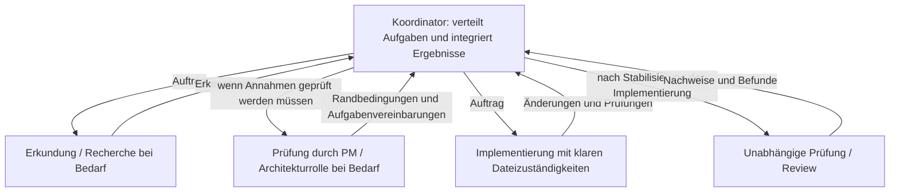

# pNet Plex

[English](README.md) · [Русский](README.ru.md) · [Deutsch](README.de.md) · [简体中文](README.zh-CN.md)

[Dokumentation](docs/translations/de/README.md) · [Tests und Effizienz](docs/translations/de/testing.md)

**Stelle dein Team zusammen. Koordiniere die Arbeit.**

pNet Plex ist ein **Agent Harness für die Orchestrierung und Koordination mehrerer
KI-Agenten** in der Softwareentwicklung. Definiere spezialisierte Rollen, wähle
Modelle und verbinde Planung, Implementierung und Review in den Coding-Werkzeugen,
die du bereits nutzt.

Ein leistungsfähiger Agent kann allein viel erreichen. Die Arbeit im Team bringt
weitere Entscheidungen mit sich: Wer übernimmt welche Aufgabe, welchen Kontext
braucht die jeweilige Rolle, welches Modell nutzt sie und wie werden Ergebnisse
geprüft? Plex macht diese Entscheidungen durch eine Teamkonfiguration im Projekt
und Skills zur Koordination explizit.

Teamdefinitionen und native Agenten liegen unter `teams/<team>/`, teamspezifische Modellprofile unter `teams/<team>/profiles/`. Der Skill `plex-setup` liest diesen Katalog aus dem Paketstamm.

Die Anweisungen für den Root-Koordinator stehen in `teams/<team>/coordinator.md`; `plex` lädt das ausgewählte Team nach Prüfung der angewendeten Konfiguration.

## Warum Plex?

Der Name leitet sich von *multiplex* ab: Mehrere Datenströme werden in einem
gemeinsamen System zusammengeführt. Bei Plex sind diese Ströme die Beiträge
spezialisierter Agenten, die auf ein gemeinsames Ergebnis hinarbeiten. Jede Rolle
hat eine klare Verantwortung; der Koordinator führt die Arbeit zusammen.

## Orchestrierung, Koordination und Agent Harness

- **Orchestrierung** strukturiert die Arbeit: passende Rollen auswählen, klar
  abgegrenzte Aufgaben delegieren, Abhängigkeiten berücksichtigen und Ergebnisse
  zur Integration zusammenführen.
- **Koordination** stimmt das Team ab: relevanten Kontext teilen, Zuständigkeiten
  für Dateien festlegen, Blockaden sichtbar machen und unabhängige Reviews organisieren.
- **Der Agent Harness** macht den Ansatz wiederholbar: Projektkonfiguration,
  wiederverwendbare Skills, Modellprofile und native Rollendefinitionen für jede
  Agentenumgebung.

Der laufende Agent übernimmt die Koordination. Plex arbeitet innerhalb der
Ausführungs- und Berechtigungsregeln der jeweiligen Umgebung, ohne separaten
Hintergrunddienst oder eigene Oberfläche. Unabhängige Aufgaben können parallel
laufen, wenn ihre Eingaben und die Dateizuständigkeiten es zulassen. Für eine
kleine Aufgabe reicht ein kleines Team; Delegation sollte einen Nutzen haben.

## Plattformen im Fokus

Plex konzentriert sich auf drei Agentenökosysteme:

| Plattform | Stand der Plex-Integration |
| --- | --- |
| **OpenAI Codex** | Implementiert; isolierte Installations- und Konfigurationsprüfungen sind vorhanden |
| **Anthropic Claude Code** | Generierung nativer Rollen implementiert; die tatsächliche Ausführung muss noch verifiziert werden |
| **Google Antigravity** mit **Gemini-Modellen** | Native Integration und ausgewählte Live-Tests verifiziert; Modell- und Clientgrenzen gelten |

Das sind die aktuellen Schwerpunkte des Produkts. Weitere Umgebungen gehören
derzeit nicht zur Roadmap. Umgebung und Modell sind getrennte Entscheidungen:
Ein Modellprofil bedeutet nicht, dass eine weitere Umgebung unterstützt wird.
Gemini CLI ist eine separate Umgebung und gehört derzeit nicht zum Integrationsumfang.

## Dein Team, deine Modelle

Starte mit **pnet**: PM klärt die Aufgabe, explorer untersucht das Projekt, researcher
prüft externe Quellen, dev implementiert, reviewer prüft Änderungen und QA das Verhalten.
Der Koordinator wählt die benötigten Rollen; standardmäßig laufen höchstens drei Aufträge parallel.
Wähle **BMad** für installierte BMad-Skills und -Workflows. pnet benötigt kein BMad.

Teamzusammensetzung und Modellwahl sind voneinander getrennt. Wähle ein Modellprofil,
passe Einstellungen einzelner Rollen an und speichere sie im Projekt. Plex erstellt
native Projektrollen und hilft dem Koordinator, sie für die aktuelle Aufgabe einzusetzen.

Verbesserungen bei Qualität, Geschwindigkeit und Kosten müssen gemessen werden;
mehr Agenten allein belegen kein besseres Ergebnis.

## So funktioniert es

Der Koordinator wählt nur die benötigten Rollen aus dem konfigurierten Team.
Klare, abgegrenzte Arbeit kann direkt in die Implementierung gehen. PM oder
Architekturrolle kommen zum Einsatz, wenn Umfang, Abnahmekriterien oder technische
Invarianten geprüft werden müssen. Recherche und Review können parallel laufen,
wenn Eingaben und Dateizuständigkeiten es erlauben.

Im BMad-Modus aktivieren Wrapper die tatsächlich installierten Skills und folgen
den Workflows und Anpassungen dieser Version. Menübefehle und Schrittfolgen sind
nicht fest einprogrammiert; vorgesehene menschliche Entscheidungspunkte bleiben
erhalten. Die Pfeile zeigen Aufträge und Rückmeldungen. Untergeordnete Agenten
dürfen nur dann weiterdelegieren, wenn Umgebung und Aufgabenübergabe dies
ausdrücklich erlauben.

## Installationsumfang und verwaltete Anweisungen

Starte `./setup.sh` und wähle einen oder mehrere Clients (Leertaste zum Markieren, Enter zum Fortfahren) und den Teamumfang. **Projekt** ist
die empfohlene Voreinstellung. **Benutzer (global)** stellt das Team für die
Projekte dieses Benutzers bereit. Codex berücksichtigt `CODEX_HOME`, Claude
`CLAUDE_CONFIG_DIR`. Für unbeaufsichtigte Installation verwende `--scope project`
mit `--project <pfad>` oder `--scope user`, jeweils mit `--client <plattform> --yes`.

Einstellungen und Installationsnachweise liegen in `.plex/` im gewählten Projekt
oder Benutzerverzeichnis der Plattform. Plex prüft Projekteinstellungen zuerst;
fehlerhafte Projekte werden gemeldet. Eine globale Installation entfernt keine
Projektagenten. Das gemeinsame Plugin wird bei allen unterstützten Plattformen für den Benutzer installiert; die Auswahl bestimmt den Umfang der Teamdateien.
Ein gemeinsames Profil — Inherit, Basic, Plus, Pro oder Pro+ — verwendet die passenden OpenAI-, Anthropic- und Google-Einstellungen für alle Clients. Für mehrere Clients ohne Menü kann `--client` wiederholt werden.
Die vollständige Installation erstellt auch `~/.local/bin/plex`; mit `--no-command` bleibt der Befehl unverändert.
Starte den Installer im eigenen Projekt oder gib `--project` an. Ein Durchlauf installiert das Plugin und richtet das Team ein; ein zusätzlicher Aufruf von `plex-setup` ist nicht erforderlich.
Der Starter nutzt `uv`, falls vorhanden, sonst Python 3.11+ mit nummerierten Menüs.

Der Installer bietet einen Block zwischen `<!-- plex:start -->` und
`<!-- plex:end -->` in der nativen Anweisungsdatei an: `AGENTS.md` für Codex,
`CLAUDE.md` für Claude, `GEMINI.md`/`AGENTS.md` für Antigravity. Vorhandene Codex
Override- und konfigurierte Fallback-Dateien werden berücksichtigt. **Plex verwaltet
nur diesen Block und erhält den gesamten übrigen Text.** Eigene Regeln gehören
außerhalb des Blocks. Änderungen werden gesichert; manuelle Änderungen im Block
und fehlerhafte Marker führen zu einem Konflikt. Wiederholte Installation erzeugt
keine doppelten Blöcke. `--no-instructions` lässt Anweisungsdateien unverändert;
`--dry-run` zeigt nur den Plan. Lade die Agentenumgebung danach neu.

## Veröffentlichungsstand

Diese frühe Entwicklungsversion enthält die Skills `plex` und `plex-setup`,
ein Installationsprogramm für die lokale Repository-Kopie (`setup.py` / `setup.sh`),
Team-Presets, Modellprofile, native Plugin-Manifeste, Dokumentation und zusammengefasste
Testergebnisse. Automatisierte Tests und rohe Versuchsdaten werden außerhalb des öffentlichen
Repositorys gepflegt. Delegation und Modellrouting brauchen clientspezifische Verifikation;
dies ist eine frühe Vorschau.

Die plattformspezifischen Manifeste liegen unter [`plugins/`](plugins/README.md). Der Installer erstellt vor der Installation ein vollständiges Paket für die gewählte Plattform.

Rollenanweisungen gliedern sich in Arbeitsschritte, Schwerpunkte, Qualitätsprüfungen und Ergebnisse. Als Vorlage dient [Awesome Codex Subagents](https://github.com/VoltAgent/awesome-codex-subagents); siehe [Drittanbieterhinweise](THIRD_PARTY_NOTICES.md).

## Lizenz

pNet Plex wird unter der [MIT-Lizenz](LICENSE) veröffentlicht.
