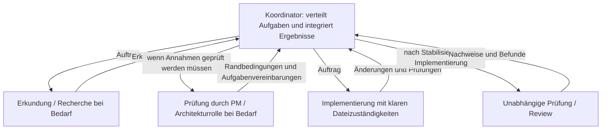

# pNet Plex

[English](README.md) · [Русский](README.ru.md) · [Deutsch](README.de.md) · [简体中文](README.zh-CN.md)

**Stelle dein Team zusammen. Koordiniere die Arbeit.**

pNet Plex ist ein **Agent Harness für die Orchestrierung und Koordination mehrerer
KI-Agenten** in der Softwareentwicklung. Definiere spezialisierte Rollen, wähle
Modelle und verbinde Planung, Implementierung und Review in den Coding-Werkzeugen,
die du bereits nutzt.

Ein leistungsfähiger Agent kann allein viel erreichen. Die Arbeit im Team bringt
weitere Entscheidungen mit sich: Wer übernimmt welche Aufgabe, welchen Kontext
braucht die jeweilige Rolle, welches Modell nutzt sie und wie werden Ergebnisse
geprüft? Plex macht diese Entscheidungen durch eine Teamkonfiguration im Projekt
und Skills zur Koordination explizit.

## Warum Plex?

Der Name leitet sich von *multiplex* ab: Mehrere Datenströme werden in einem
gemeinsamen System zusammengeführt. Bei Plex sind diese Ströme die Beiträge
spezialisierter Agenten, die auf ein gemeinsames Ergebnis hinarbeiten. Jede Rolle
hat eine klare Verantwortung; der Koordinator führt die Arbeit zusammen.

## Orchestrierung, Koordination und Agent Harness

- **Orchestrierung** strukturiert die Arbeit: passende Rollen auswählen, klar
  abgegrenzte Aufgaben delegieren, Abhängigkeiten berücksichtigen und Ergebnisse
  zur Integration zusammenführen.
- **Koordination** stimmt das Team ab: relevanten Kontext teilen, Zuständigkeiten
  für Dateien festlegen, Blockaden sichtbar machen und unabhängige Reviews organisieren.
- **Der Agent Harness** macht den Ansatz wiederholbar: Projektkonfiguration,
  wiederverwendbare Skills, Modellprofile und native Rollendefinitionen für jede
  Agentenumgebung.

Der laufende Agent übernimmt die Koordination. Plex arbeitet innerhalb der
Ausführungs- und Berechtigungsregeln der jeweiligen Umgebung, ohne separaten
Hintergrunddienst oder eigene Oberfläche. Unabhängige Aufgaben können parallel
laufen, wenn ihre Eingaben und die Dateizuständigkeiten es zulassen. Für eine
kleine Aufgabe reicht ein kleines Team; Delegation sollte einen Nutzen haben.

## Plattformen im Fokus

Plex konzentriert sich auf drei Agentenökosysteme:

| Plattform | Stand der Plex-Integration |
| --- | --- |
| **OpenAI Codex** | Implementiert; isolierte Installations- und Konfigurationsprüfungen sind vorhanden |
| **Anthropic Claude Code** | Generierung nativer Rollen implementiert; die tatsächliche Ausführung muss noch verifiziert werden |
| **Google Antigravity** mit **Gemini-Modellen** | In Entwicklung; Vorlagen und Google-Modellprofile sind vorhanden, die durchgängige Unterstützung ist noch nicht verifiziert |

Das sind die aktuellen Schwerpunkte des Produkts. Weitere Umgebungen gehören
derzeit nicht zur Roadmap. Umgebung und Modell sind getrennte Entscheidungen:
Ein Modellprofil bedeutet nicht, dass eine weitere Umgebung unterstützt wird.
Gemini CLI ist eine separate Umgebung und gehört derzeit nicht zum Integrationsumfang.

## Dein Team, deine Modelle

Starte mit **default**: PM untersucht die Aufgabe und plant, dev implementiert und
testet, reviewer prüft das Ergebnis unabhängig. Wähle **BMad**, um einen größeren
Rollensatz mit installierten BMad-Skills und -Workflows zu nutzen. Das Team default
funktioniert ohne BMad.

Teamzusammensetzung und Modellwahl sind voneinander getrennt. Wähle ein Modellprofil,
passe Einstellungen einzelner Rollen an und speichere sie im Projekt. Plex erstellt
native Projektrollen und hilft dem Koordinator, sie für die aktuelle Aufgabe einzusetzen.

Verbesserungen bei Qualität, Geschwindigkeit und Kosten müssen gemessen werden;
mehr Agenten allein belegen kein besseres Ergebnis.

## So funktioniert es

Der Koordinator wählt nur die benötigten Rollen aus dem konfigurierten Team.
Klare, abgegrenzte Arbeit kann direkt in die Implementierung gehen. PM oder
Architekturrolle kommen zum Einsatz, wenn Umfang, Abnahmekriterien oder technische
Invarianten geprüft werden müssen. Recherche und Review können parallel laufen,
wenn Eingaben und Dateizuständigkeiten es erlauben.

Im BMad-Modus aktivieren Wrapper die tatsächlich installierten Skills und folgen
den Workflows und Anpassungen dieser Version. Menübefehle und Schrittfolgen sind
nicht fest einprogrammiert; vorgesehene menschliche Entscheidungspunkte bleiben
erhalten. Die Pfeile zeigen Aufträge und Rückmeldungen. Untergeordnete Agenten
dürfen nur dann weiterdelegieren, wenn Umgebung und Aufgabenübergabe dies
ausdrücklich erlauben.

## Veröffentlichungsstand

Diese frühe Entwicklungsversion enthält die Skills `plex` und `plex-setup`,
ein Installationsprogramm für die lokale Repository-Kopie (`setup.py` / `setup.sh`),
Team-Presets, Modellprofile und native Plugin-Manifeste. Vollständige Dokumentation
und Tests sind noch nicht Teil dieser Veröffentlichung. Tatsächliche Delegation
und Modellzuordnung müssen weiterhin in jeder Umgebung verifiziert werden;
dies ist kein stabiler Release.

## Lizenz

pNet Plex wird unter der [MIT-Lizenz](LICENSE) veröffentlicht.
