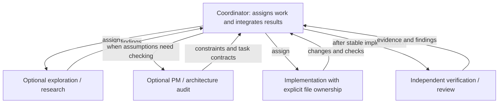

# pNet Plex

[English](README.md) · [Русский](README.ru.md) · [Deutsch](README.de.md) · [简体中文](README.zh-CN.md)

**Compose your team. Coordinate the work.**

pNet Plex is an **agent harness for multi-agent orchestration and coordination**
in software development. Define specialist roles, choose models, and bring planning,
implementation, and review together inside the coding tools you already use.

A capable agent can do a lot on its own. Working as a team introduces another set
of decisions: who owns each task, what context they need, which model they use,
and how their results are checked. Plex makes those decisions explicit through
project team configuration and coordination skills.

## Why Plex?

The name draws from *multiplex*: bringing multiple streams together through a
shared system. In Plex, those streams are the contributions of specialized agents,
coordinated toward a common result. Each role has a clear responsibility; the
coordinator brings the work together.

## Agent orchestration, coordination, and the harness

- **Orchestration** structures the work: select useful roles, delegate bounded
  tasks, respect dependencies, and bring results back for integration.
- **Coordination** keeps the team aligned: share relevant context, establish file
  ownership, surface blockers, and arrange independent review.
- **The agent harness** makes that approach repeatable: project configuration,
  reusable skills, model profiles, and native role definitions for each host.

The running agent acts as coordinator. Plex works within the host's execution and
permission model, without a separate daemon or UI. Independent assignments can run
in parallel when their inputs and file ownership allow it. A small task can use a
small team; delegation should earn its place.

## Platform focus

Plex focuses on three agent ecosystems:

| Platform | Plex integration status |
| --- | --- |
| **OpenAI Codex** | Implemented; isolated installation and configuration checks available |
| **Anthropic Claude Code** | Native role rendering implemented; live execution verification remains |
| **Google Antigravity**, with **Gemini models** | In development; templates and Google model profiles are present, end-to-end support is not yet verified |

These are the current product focus. Additional hosts are outside the current
roadmap. Hosts and models are separate choices: a model profile does not establish
support for another host. Gemini CLI is a separate host and is not included in
the current integration scope.

## Your team, your models

Start with **default**: PM explores and plans, dev implements and tests, and
reviewer independently checks the result. Choose **BMad** to use the broader role
set with installed BMad skills and workflows. The default team works without BMad.

Team composition is separate from model selection. Choose a model profile, adjust
per-role settings, and keep those choices in your project. Plex creates native
project roles and helps the coordinator use them for the work at hand.

Quality, speed, and cost improvements require measurement; more agents alone do
not establish a better outcome.

## How It Works

The coordinator chooses only useful roles from the applied team. Clear, bounded
work can go directly to implementation. PM or architect is used when scope,
acceptance criteria or technical invariants need verification. Recon and review
can run in parallel when inputs and file ownership permit it.

In BMad mode, wrappers activate real installed skills and follow that version's
workflow and customization. They do not hardcode menu codes or step sequences,
and preserve human decision gates. Diagram arrows are assignments and returns;
children may delegate only with explicit host and handoff authorization.

## Publication status

This early development preview includes the `plex` and `plex-setup` skills,
a checkout installer (`setup.py` / `setup.sh`), team presets, model profiles, and
native plugin manifests. Full documentation and tests are not included in this
publication yet. Live delegation and model routing still require host-specific
verification; this is not a stable release.

## License

pNet Plex is released under the [MIT License](LICENSE).
