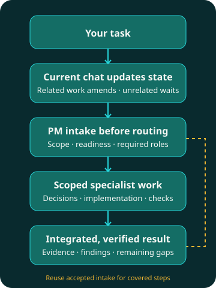

<p align="center"></p>

# Plex AI

**Compose your team. Coordinate the work.**

An open-source **agent harness for multi-agent orchestration and coordination** in
OpenAI Codex, Anthropic Claude Code and Google Antigravity. Compose specialist teams,
choose model profiles, and integrate verified work inside your coding client.

[](https://github.com/pnetcloud/plex-ai/releases/latest) [](https://github.com/pnetcloud/plex-ai/actions/workflows/ci.yml) [](https://github.com/pnetcloud/plex-ai/blob/main/LICENSE)

**[Install](#quickstart)** · **[How it works](#how-it-works)** · **[Documentation](docs/README.md)** · **[Releases](https://github.com/pnetcloud/plex-ai/releases/latest)** · **[Report an issue](https://github.com/pnetcloud/plex-ai/issues)**

[English](README.md) · [Русский](docs/translations/ru/README.md) · [Deutsch](docs/translations/de/README.md) · [简体中文](docs/translations/zh-CN/README.md)

**Status: Active development; released for evaluation.** Support and verification coverage vary by
client.

## Quickstart

Run from your project directory. Requires Git, curl, the selected client CLI, and uv or Python 3.11+.
[Review the installer](install.sh) before executing it.

```sh
curl -fsSL https://raw.githubusercontent.com/pnetcloud/plex-ai/main/install.sh | bash
```

Choose clients, team and model profile; confirm the plan. **Project** scope is recommended.
Open a new client session, then ask Plex to coordinate a task:

```text
$plex Coordinate <task>. Requirements: <requirements>. Verify <acceptance criteria>.
```

This is a **Codex chat request**, not a shell command. [Other clients](#use-in-chat) use their native skill entry point.

<details>
<summary><strong>Dev mode · Codex · project-local skills</strong></summary>

```sh
curl -fsSL https://raw.githubusercontent.com/pnetcloud/plex-ai/main/install.sh | bash -s -- --dev --client codex
```

Uses live project-local skill links instead of the shared Plex plugin in that project.

</details>

Setup installs the shared skills and configures native team roles with a managed instruction
block. Plugin installation alone does not configure a team. Existing surrounding instructions
are preserved. BMad mode offers its selected dependencies and project initialization.

[Prerequisites, installation options and BMad setup →](docs/installation.md)

## How it works

**Your current chat remains the coordinator and keeps its model.** Every new task first goes to
`plex-pm` for a short assessment. The coordinator follows that assessment, collects
required specialist decisions, then assigns implementation and verifies the result.
Independent assignments can run concurrently; covered steps reuse the assessment.



The diagram illustrates the workflow, not a separate application interface. A team is a toolbox,
not a pipeline that must run every role. Plex works within your client's permissions.
Installation does not activate coordination: invoke the `plex` skill when you want it.

## What you get

| Capability | What it gives you |
|---|---|
| **Specialist teams** | [Planning, exploration, development, review and QA](docs/product.md), selected for the task |
| **Model profiles** | [Subagent models and reasoning](docs/configuration.md) configured independently of the main chat |
| **Bounded delegation** | [Clear assignments, context and write ownership](docs/role-contracts.md) |
| **Review and verification** | [Independent checks and completion evidence](docs/role-contracts.md), with unresolved gaps reported |
| **Native integration** | [Roles and skills inside your existing client](docs/host-compatibility.md) |
| **Optional BMad** | [Installed BMad personas and workflows](teams/bmad/README.md), with model-aware delegation |

## Supported coding clients

| Client | Integration | Verification coverage |
|---|---|---|
| **OpenAI Codex** | Native plugin, roles and instructions | Installation and selected live trials |
| **Google Antigravity** | Native skills and role configuration | Installation and selected live trials; host/model restrictions apply |
| **Anthropic Claude Code** | Native plugin, agents and instructions | Native setup tested; live coding end-to-end execution remains unverified |

[Compatibility, native paths and limitations →](docs/host-compatibility.md)
Gemini models through Antigravity do not imply Gemini CLI support.

## Teams and model profiles

| Team | Specialists | Best starting point |
|---|---|---|
| **pnet** | PM, explorer, researcher, dev, reviewer, QA | General development; no BMad required |
| **bmad** | Analyst, PM, PO, UX, architect, dev, reviewer | Work using installed BMad workflows |

Profiles: **Inherit · Basic · Plus · Pro · Pro+**. They configure subagents; the
main-chat model remains your choice. Setup shows a profile-specific coordinator
recommendation without switching the running chat's model.

### Agent orchestration modes

Plex is an **AI agent orchestrator** inside your coding client. Your chat acts as the
**coordinator**: PM frames the task, specialist subagents contribute decisions,
and developers implement work for review. Model profiles assign Luna, Sol and Astra
or Haiku, Sonnet and Opus to those roles; the coordinator retains your chat model.

Choose three independent settings: **team** (`pnet` or BMad workflows),
**model profile** (Inherit / Basic / Plus / Pro / Pro+) and **interaction mode**:

| Mode | How the team works with you |
|---|---|
| **Interactive** | Discuss requirements and meaningful choices together |
| **Balanced** · default | Resolve routine choices; ask about consequential unresolved decisions and required checkpoints |
| **Auto** | Execute authorized work without waiting for answers; report results and blockers |

### Models by profile

These are **Plex configuration profiles**, independent of provider subscription plans.
Each cell shows **development → code review** in the bundled `pnet` team.

| Client / model provider | Basic | Plus | Pro | Pro+ |
|---|---|---|---|---|
| OpenAI Codex | Luna → Luna | Luna → Sol | Luna → Sol | Sol → Astra |
| Claude Code / Anthropic | Haiku → Haiku | Haiku → Sonnet | Haiku → Sonnet | Sonnet → Opus |
| Antigravity / Google Gemini | `flash` → `flash` | `flash` → `inherit` | `inherit` → `inherit` | `inherit` → `inherit` |
| Antigravity / Anthropic | Sonnet low → Sonnet low | Sonnet low → Sonnet medium | Sonnet medium → Opus medium | Sonnet medium → Opus high |

- **Basic:** one base model across `pnet` roles. **Plus:** separate implementation and review models where configured.
- **Pro:** more reasoning for selected roles; model families may stay the same. **Pro+:** Sol/Sonnet development with Astra/Opus review in the OpenAI/Anthropic profiles.
- **BMad:** the same development/review pairs, except Basic already uses Sol, Sonnet, `inherit` or Sonnet medium for review, respectively. Planning, architecture and other roles have their own settings.
- **Inherit:** use client/session defaults. In the Gemini profiles, `inherit` is not a pinned Gemini Pro model.

Configured IDs: Luna = `gpt-6-luna`, Sol = `gpt-6.1-sol`, Astra = `gpt-6-astra`.
Claude Code uses `haiku`, `sonnet`, `opus` aliases; the Antigravity Anthropic profiles use
`claude-sonnet-5-5-low`, `claude-sonnet-5-5-medium`, `claude-opus-5-5-medium` and `claude-opus-5-5-high`.
These are shipped settings, not a guarantee of model availability or cost savings. Setup shows effective settings including project overrides.

[All pnet role settings](teams/pnet/profiles/) · [All BMad role settings](teams/bmad/profiles/) · [Profile configuration](docs/configuration.md)

Choose interaction and concurrency settings for your project. **Update only** preserves
settings; **Reconfigure** opens the menus. See [configuration](docs/configuration.md).

## Use in chat

These are **chat requests, not terminal commands**. Replace the placeholders.

**Codex** — the same short names work in standard and dev installations:

```text
$plex Coordinate <task>. Requirements: <requirements>. Verify <acceptance criteria>.
$plex Review <change> against <requirements>. Report findings and verification gaps.
$plex-setup Check this project's Plex configuration.
```

**Claude Code:**

```text
/pnet-plex:plex Coordinate <task>. Requirements: <requirements>. Verify <acceptance criteria>.
/pnet-plex:plex-setup Check this project's Plex configuration.
```

In other clients, select the installed skill or ask: `Use Plex to coordinate <task>.`
`plex-setup` configures the team; `plex` coordinates its work.

## Terminal commands

| Command | Purpose |
|---|---|
| `plex` | Configure or refresh this project |
| `plex status` | Check the installation |
| `plex update` | Download an update and open setup |
| `plex uninstall --dry-run` | Preview team removal |
| `plex uninstall` | Remove this project's managed team |

If the optional command is absent, use `~/.local/share/plex-ai/setup.sh`.
Uninstall preserves surrounding instructions, preferences, backups and the shared plugin.
[Full CLI reference and shared-plugin removal →](docs/installation.md#uninstall)

## Evidence and limitations

[Testing and efficiency](docs/testing.md) documents how trials were conducted, measured token
usage, historical cost estimates and the owner's subjective quality assessments. Early
single-run comparisons are observations, not statistical proof or a guarantee of savings.
[Compatibility](docs/host-compatibility.md) separates configuration checks from live model execution.

Plex has no separate daemon or web UI. Interfaces may change as the project develops.

## Documentation and contributing

**[Documentation](docs/README.md)** · **[Architecture](docs/architecture.md)** · **[Contributing](CONTRIBUTING.md)** · **[Changelog](CHANGELOG.md)** · **[Issues](https://github.com/pnetcloud/plex-ai/issues)**

Plex AI by pNet (previously presented as pNet Plex). CLI and skill names remain `plex`.
[MIT license](LICENSE). Adapted role instructions credit
[Awesome Codex Subagents](https://github.com/VoltAgent/awesome-codex-subagents);
see [third-party notices](THIRD_PARTY_NOTICES.md).
