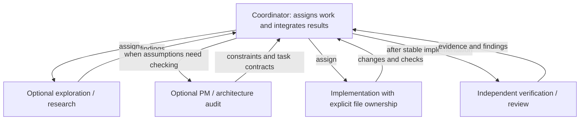

# pNet Plex

[English](README.md) · [Русский](README.ru.md) · [Deutsch](README.de.md) · [简体中文](README.zh-CN.md)

[Documentation](docs/README.md) · [Testing and efficiency](docs/testing.md)

**Compose your team. Coordinate the work.**

pNet Plex is an **agent harness for multi-agent orchestration and coordination**
in software development. Define specialist roles, choose models, and bring planning,
implementation, and review together inside the coding tools you already use.

A capable agent can do a lot on its own. Working as a team introduces another set
of decisions: who owns each task, what context they need, which model they use,
and how their results are checked. Plex makes those decisions explicit through
project team configuration and coordination skills.

Team definitions and native agents live in `teams/<team>/`; team-specific model profiles live in `teams/<team>/profiles/`. The `plex-setup` skill reads this package-level catalog.

The root coordinator instructions live in `teams/<team>/coordinator.md`; `plex` loads the selected team after checking its applied configuration.

## Why Plex?

The name draws from *multiplex*: bringing multiple streams together through a
shared system. In Plex, those streams are the contributions of specialized agents,
coordinated toward a common result. Each role has a clear responsibility; the
coordinator brings the work together.

## Agent orchestration, coordination, and the harness

- **Orchestration** structures the work: select useful roles, delegate bounded
  tasks, respect dependencies, and bring results back for integration.
- **Coordination** keeps the team aligned: share relevant context, establish file
  ownership, surface blockers, and arrange independent review.
- **The agent harness** makes that approach repeatable: project configuration,
  reusable skills, model profiles, and native role definitions for each host.

The running agent acts as coordinator. Plex works within the host's execution and
permission model, without a separate daemon or UI. Independent assignments can run
in parallel when their inputs and file ownership allow it. A small task can use a
small team; delegation should earn its place.

## Platform focus

Plex focuses on three agent ecosystems:

| Platform | Plex integration status |
| --- | --- |
| **OpenAI Codex** | Implemented; isolated installation and configuration checks available |
| **Anthropic Claude Code** | Native role rendering implemented; live execution verification remains |
| **Google Antigravity**, with **Gemini models** | Native integration and selected live trials verified; model and host restrictions apply |

These are the current product focus. Additional hosts are outside the current
roadmap. Hosts and models are separate choices: a model profile does not establish
support for another host. Gemini CLI is a separate host and is not included in
the current integration scope.

## Your team, your models

Start with **pnet**: PM frames the task, explorer maps the project, researcher verifies
external sources, dev implements, reviewer inspects changes, and QA verifies behavior.
The coordinator selects only useful roles; the default concurrency limit remains three.
Choose **BMad** for assignments using installed BMad skills and workflows. pnet needs no BMad.

Team composition is separate from model selection. Choose a model profile, adjust
per-role settings, and keep those choices in your project. Plex creates native
project roles and helps the coordinator use them for the work at hand.

Quality, speed, and cost improvements require measurement; more agents alone do
not establish a better outcome.

## How It Works



The coordinator chooses only useful roles from the applied team. Clear, bounded
work can go directly to implementation. PM or architect is used when scope,
acceptance criteria or technical invariants need verification. Recon and review
can run in parallel when inputs and file ownership permit it.

In BMad mode, wrappers activate real installed skills and follow that version's
workflow and customization. They do not hardcode menu codes or step sequences,
and preserve human decision gates. Diagram arrows are assignments and returns;
children may delegate only with explicit host and handoff authorization.

## Installation scope and managed instructions

Run `./setup.sh` to select one or more clients (Space to toggle, Enter to continue) and the team scope. **Project** is the
recommended default; **User (global)** makes the team available across that user's
projects. Codex respects `CODEX_HOME`; Claude respects `CLAUDE_CONFIG_DIR`.

```sh
./setup.sh --project /path/to/project --client codex --scope project --yes
./setup.sh --client codex --scope user --yes
```

Plex keeps its settings and receipts in `.plex/` under the selected project or
host user directory. Project settings take precedence in Plex's configuration
checks; a broken project setup is reported rather than bypassed. Installing user
defaults never deletes project roles. The shared plugin is installed for the user in every supported host; the selected scope controls the team files.
Choose one profile — Inherit, Basic, Plus, Pro or Pro+ — for all selected clients. Plex combines the corresponding OpenAI, Anthropic and Google settings automatically. Repeat `--client` for unattended multi-client setup.
A full run also creates `~/.local/bin/plex`; use `--no-command` to skip the shortcut.
Run the installer from your project directory, or specify `--project`. One run installs the plugin and configures the team; no separate `plex-setup` step is required.
The launcher uses `uv` when available, otherwise Python 3.11+ with numbered menus.

The installer offers to add a small block between `<!-- plex:start -->` and
`<!-- plex:end -->` in the native instruction file: `AGENTS.md` for Codex,
`CLAUDE.md` for Claude, or `GEMINI.md`/`AGENTS.md` for Antigravity. Codex's existing
override and configured fallback files are respected. **Plex manages only its
block, preserving all surrounding text.** Keep personal rules outside the block.
Updates back up changed files; manual edits inside the block and malformed markers
are reported as conflicts. Repeated installation does not duplicate the block.
Use `--no-instructions` to leave instruction files unchanged or `--dry-run` to
preview without writes. Reload the host after applying changes.

## Publication status

This early development preview includes the `plex` and `plex-setup` skills,
a checkout installer (`setup.py` / `setup.sh`), team presets, model profiles, and
native plugin manifests, documentation and compiled testing results. Automated tests
and raw trial evidence are maintained separately from the public repository. Live
delegation and model routing require host-specific verification; this is an early preview.

Host distribution manifests live in [`plugins/`](plugins/README.md). The checkout installer assembles a complete package for the selected host before installation.


Role instructions use explicit working steps, focus, quality checks and return contracts. They adapt [Awesome Codex Subagents](https://github.com/VoltAgent/awesome-codex-subagents); see [third-party notices](THIRD_PARTY_NOTICES.md).

## License

pNet Plex is released under the [MIT License](LICENSE).
