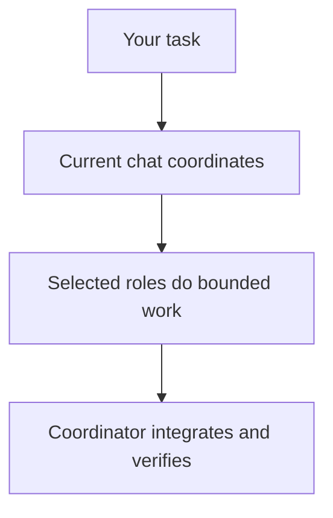

# pNet Plex

[English](README.md) · [Русский](docs/translations/ru/README.md) · [Deutsch](docs/translations/de/README.md) · [简体中文](docs/translations/zh-CN/README.md)

**Compose your team. Coordinate the work.**

Plex is an **agent harness for multi-agent orchestration and coordination** in
OpenAI Codex, Anthropic Claude Code and Google Antigravity. Install a reusable team,
choose its model profile, and ask Plex to organize implementation, review and verification.

**[v0.5.10](https://github.com/pnetcloud/plex-ai/releases/tag/v0.5.10)** — open source, MIT. Ready to try; interfaces may change.

## Install

Run in your project directory:

```sh
curl -fsSL https://raw.githubusercontent.com/pnetcloud/plex-ai/main/install.sh | bash
```

**Dev mode · Codex · project-local skills**

```sh
curl -fsSL https://raw.githubusercontent.com/pnetcloud/plex-ai/main/install.sh | bash -s -- --dev --client codex
```

Choose clients, scope, team and model profile; confirm the plan. **Project** scope is recommended. Open a new client session afterwards.

The normal installer handles both parts:

- **Shared plugin** — reusable `plex` and `plex-setup` skills for the client.
- **Team setup** — native agent roles and the managed instruction block, at project or user scope.

Plugin installation alone does not configure a team. Dev mode uses project-local skill links instead of the shared Plex plugin in that project.

[Prerequisites, BMad, dev mode and all options](docs/installation.md).

## How it works

Your current chat stays coordinator and keeps its model. It delegates useful work, integrates results and verifies the outcome. Small tasks can stay local.



## Use in chat

These are **chat requests, not terminal commands**. Replace the angle-bracket placeholders before sending.

**Coordinate a task · Codex plugin**

```text
$plex Coordinate <task>. Requirements: <requirements>. Verify <acceptance criteria>.
```

**Review a change**

```text
$plex Review <change> against <requirements>. Report findings and verification gaps.
```

**Check or configure the team**

```text
$plex-setup Check this project's Plex configuration.
$plex-setup Configure this project: team <team>, profile <profile>, interaction <mode>.
```

**Coordinate a task · Claude Code plugin**

```text
/pnet-plex:plex Coordinate <task>. Requirements: <requirements>. Verify <acceptance criteria>.
/pnet-plex:plex-setup Check this project's Plex configuration.
```

Codex uses `$plex` and `$plex-setup` in both standard and dev installations. Other clients can select the installed skill or explicitly ask: `Use Plex to coordinate <task>.`

Installation does not start coordination automatically. `plex-setup` changes configuration; `plex` coordinates work.

## Teams and models

| Team | Purpose |
|---|---|
| **pnet** | General development: PM, explorer, researcher, dev, reviewer and QA; no BMad required |
| **bmad** | Installed BMad personas and workflows; setup offers selected dependencies and project initialization |

Choose **Inherit, Basic, Plus, Pro or Pro+** for subagents. The main-chat model remains your choice; setup shows a profile-specific recommendation. See [configuration](docs/configuration.md).

## Terminal commands

| Task | Command |
|---|---|
| Configure or refresh this project | `plex` |
| Check installation | `plex status` |
| Download an update and open setup | `plex update` |
| Preview team removal | `plex uninstall --dry-run` |
| Remove this project's team | `plex uninstall` |

If the optional `plex` command is absent, use `~/.local/share/plex-ai/setup.sh` instead. During setup, **Update only** keeps settings; **Reconfigure** opens the menus.

## Uninstall

Run `plex uninstall` from the project directory. It removes unchanged managed roles, the Plex instruction block and owned skill links and dev overrides; surrounding instructions are preserved. Preferences, backups and the shared plugin remain.

To also remove the shared **Codex plugin** once other projects no longer need it:

```sh
codex plugin remove pnet-plex@pnet-plex
```

For other clients and user-wide team removal, see [uninstallation](docs/installation.md#uninstall).

## Learn more

- [Report a problem](https://github.com/pnetcloud/plex-ai/issues).
- [Documentation](docs/README.md) — setup and usage details.
- [Contributing](CONTRIBUTING.md).
- [About Plex](docs/product.md) — purpose and working principles.
- [Compatibility](docs/host-compatibility.md) — Codex and selected Antigravity live trials; native Claude Code live execution remains unverified.
- [Testing and efficiency](docs/testing.md) — methodology, measured token/cost results and subjective quality observations.
- [Architecture](docs/architecture.md) — how configuration and coordination fit together.

## License

[MIT](LICENSE). Agent instructions adapt [Awesome Codex Subagents](https://github.com/VoltAgent/awesome-codex-subagents);
see [third-party notices](THIRD_PARTY_NOTICES.md).
