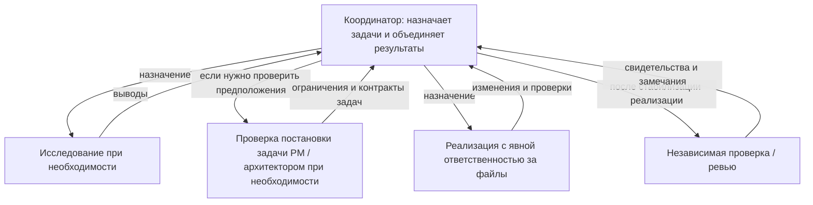

# pNet Plex

[English](README.md) · [Русский](README.ru.md) · [Deutsch](README.de.md) · [简体中文](README.zh-CN.md)

[Документация](docs/translations/ru/README.md) · [Тестирование и эффективность](docs/translations/ru/testing.md)

**Соберите команду. Координируйте работу.**

pNet Plex — **agent harness для оркестрации и координации нескольких AI-агентов**
в разработке программного обеспечения. Определяйте роли специалистов, выбирайте
модели и объединяйте планирование, реализацию и ревью в привычных инструментах
разработки с агентами.

Способный агент многое может сделать самостоятельно. Командная работа добавляет
новые вопросы: кто отвечает за каждую задачу, какой контекст ему нужен, какую модель
он использует и как проверяется результат. Plex делает эти решения явными через
конфигурацию команды в проекте и skills координации.

Команды и их нативные агенты находятся в `teams/<team>/`, профили моделей каждой команды — в `teams/<team>/profiles/`. Скилл `plex-setup` читает этот каталог из корня пакета.

Инструкции root coordinator находятся в `teams/<team>/coordinator.md`; `plex` читает файл выбранной команды после проверки применённой конфигурации.

## Почему Plex?

Название происходит от *multiplex*: объединения нескольких потоков в общей системе.
В Plex эти потоки — вклад специализированных агентов, работающих над общим
результатом. У каждой роли есть понятная ответственность; координатор собирает
результаты в единое целое.

## Оркестрация, координация и agent harness

- **Оркестрация** задаёт порядок работы: выбрать нужные роли, делегировать задачи
  с чёткими границами, учесть зависимости и собрать результаты для интеграции.
- **Координация** согласует действия команды: передать нужный контекст, распределить
  ответственность за файлы, выявить блокеры и организовать независимое ревью.
- **Agent harness** делает этот подход воспроизводимым: конфигурация проекта,
  переиспользуемые skills, профили моделей и нативные определения ролей для каждой
  агентской среды.

Координатором выступает текущий агент. Plex работает в рамках возможностей
выполнения и разрешений выбранной среды, без отдельного фонового сервиса или
интерфейса. Независимые задачи могут выполняться параллельно, если это допускают
их входные данные и распределение ответственности за файлы. Небольшой задаче
достаточно небольшой команды; делегирование должно приносить пользу.

## Основные платформы

Plex сосредоточен на трёх агентских экосистемах:

| Платформа | Состояние интеграции Plex |
| --- | --- |
| **OpenAI Codex** | Реализована; есть изолированные проверки установки и конфигурации |
| **Anthropic Claude Code** | Генерация нативных ролей реализована; выполнение в рабочей среде ещё требует проверки |
| **Google Antigravity** с **моделями Gemini** | Нативная интеграция и отдельные живые тесты проверены; действуют ограничения среды и моделей |

Это текущие направления развития продукта. Другие среды пока не входят в roadmap.
Среда и модель выбираются отдельно: наличие профиля модели не означает поддержку
ещё одной среды. Gemini CLI — отдельная среда, которая сейчас не входит в область
интеграции.

## Ваша команда, ваши модели

Начните с **pnet**: PM уточняет задачу, explorer исследует проект, researcher проверяет
внешние источники, dev реализует, reviewer проверяет изменения, QA — работающее поведение.
Координатор выбирает нужные роли; лимит параллельных агентов по умолчанию — три.
Выберите **BMad** для работы через установленные skills и workflows BMad. pnet не требует BMad.

Состав команды отделён от выбора моделей. Выберите профиль моделей, настройте
параметры отдельных ролей и сохраните их в проекте. Plex создаёт нативные роли
проекта и помогает координатору использовать их для текущей задачи.

Улучшение качества, скорости и стоимости нужно измерять; само по себе увеличение
числа агентов не гарантирует лучшего результата.

## Как это работает



Координатор выбирает из настроенной команды только нужные роли. Понятная задача
с чёткими границами может сразу перейти к реализации. PM или архитектор подключается,
когда нужно проверить объём работ, критерии приёмки или технические инварианты.
Исследование и ревью могут идти параллельно, если это допускают входные данные
и распределение ответственности за файлы.

В режиме BMad обёртки активируют реально установленные skills и следуют workflow
и настройкам этой версии. Они сохраняют предусмотренные точки решения человека,
не фиксируя в коде команды меню или последовательности шагов. Стрелки на диаграмме
обозначают назначения и возврат результатов; дочерние агенты могут делегировать
работу дальше только при явном разрешении среды и контракта передачи задачи.

## Установка и управление инструкциями

Запустите `./setup.sh`: в начале можно отметить несколько клиентов пробелом и продолжить клавишей Enter, затем выбрать область установки команды.
**На уровне проекта** — рекомендуемый вариант по умолчанию. **Глобально для
пользователя** — общая команда для его проектов. Codex учитывает `CODEX_HOME`,
Claude — `CLAUDE_CONFIG_DIR`.

```sh
./setup.sh --project /путь/к/проекту --client codex --scope project --yes
./setup.sh --client codex --scope user --yes
```

Настройки и квитанции Plex находятся в `.plex/` выбранного проекта или
пользовательского каталога платформы. При проверке Plex проектные настройки
имеют приоритет: неисправная конфигурация выдаёт ошибку. Глобальная установка
не удаляет проектных агентов. Общий плагин устанавливается пользователю во всех поддерживаемых средах; выбранная область определяет размещение команды.
Выбирается один профиль — Inherit, Basic, Plus, Pro или Pro+ — для всех клиентов. Plex автоматически использует соответствующие настройки OpenAI, Anthropic и Google. Для запуска без меню повторяйте параметр `--client`.
Полная установка также создаёт `~/.local/bin/plex`; `--no-command` отключает создание ярлыка.
Запускайте установщик из своего проекта либо указывайте `--project`. Один запуск устанавливает плагин и настраивает команду — отдельно вызывать `plex-setup` не требуется.
При наличии `uv` используются меню со стрелками; иначе достаточно Python 3.11+ для текстового меню.

Установщик предлагает добавить небольшой блок между `<!-- plex:start -->` и
`<!-- plex:end -->` в нативный файл инструкций: `AGENTS.md` у Codex, `CLAUDE.md`
у Claude или `GEMINI.md`/`AGENTS.md` у Antigravity. У Codex учитываются существующий
override и настроенные fallback-файлы. **Plex управляет только своим блоком,
сохраняя весь окружающий текст.** Личные правила размещайте за пределами блока.
Перед изменениями создаются резервные копии; ручные правки внутри блока и
некорректные маркеры считаются конфликтом. Повторная установка не дублирует блок.
`--no-instructions` оставляет файлы инструкций без изменений, `--dry-run`
показывает план без записи. После применения перезагрузите среду агента.

## Состояние публикации

Эта ранняя версия для ознакомления включает skills `plex` и `plex-setup`,
установщик из локальной копии репозитория (`setup.py` / `setup.sh`), пресеты команд,
профили моделей, нативные манифесты плагинов, документацию и сводные результаты тестирования.
Автоматические тесты и исходные материалы прогонов хранятся отдельно от публичного репозитория.
Делегирование и выбор моделей требуют проверки в каждой среде; это ранняя версия для ознакомления.

Манифесты для платформ находятся в [`plugins/`](plugins/README.md). Установщик собирает полный пакет для выбранной платформы перед установкой.


Инструкции ролей разделены на порядок работы, фокус, проверки и результат. Они адаптированы с опорой на [Awesome Codex Subagents](https://github.com/VoltAgent/awesome-codex-subagents); см. [уведомления о сторонних материалах](THIRD_PARTY_NOTICES.md).

## Лицензия

pNet Plex распространяется под [лицензией MIT](LICENSE).
