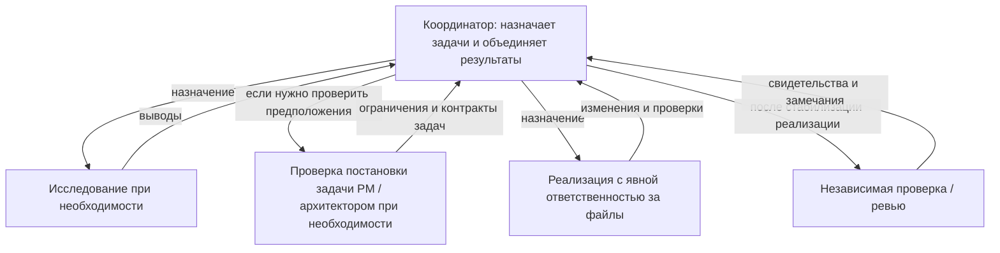

# pNet Plex

[English](README.md) · [Русский](README.ru.md) · [Deutsch](README.de.md) · [简体中文](README.zh-CN.md)

**Соберите команду. Координируйте работу.**

pNet Plex — **agent harness для оркестрации и координации нескольких AI-агентов**
в разработке программного обеспечения. Определяйте роли специалистов, выбирайте
модели и объединяйте планирование, реализацию и ревью в привычных инструментах
разработки с агентами.

Способный агент многое может сделать самостоятельно. Командная работа добавляет
новые вопросы: кто отвечает за каждую задачу, какой контекст ему нужен, какую модель
он использует и как проверяется результат. Plex делает эти решения явными через
конфигурацию команды в проекте и skills координации.

## Почему Plex?

Название происходит от *multiplex*: объединения нескольких потоков в общей системе.
В Plex эти потоки — вклад специализированных агентов, работающих над общим
результатом. У каждой роли есть понятная ответственность; координатор собирает
результаты в единое целое.

## Оркестрация, координация и agent harness

- **Оркестрация** задаёт порядок работы: выбрать нужные роли, делегировать задачи
  с чёткими границами, учесть зависимости и собрать результаты для интеграции.
- **Координация** согласует действия команды: передать нужный контекст, распределить
  ответственность за файлы, выявить блокеры и организовать независимое ревью.
- **Agent harness** делает этот подход воспроизводимым: конфигурация проекта,
  переиспользуемые skills, профили моделей и нативные определения ролей для каждой
  агентской среды.

Координатором выступает текущий агент. Plex работает в рамках возможностей
выполнения и разрешений выбранной среды, без отдельного фонового сервиса или
интерфейса. Независимые задачи могут выполняться параллельно, если это допускают
их входные данные и распределение ответственности за файлы. Небольшой задаче
достаточно небольшой команды; делегирование должно приносить пользу.

## Основные платформы

Plex сосредоточен на трёх агентских экосистемах:

| Платформа | Состояние интеграции Plex |
| --- | --- |
| **OpenAI Codex** | Реализована; есть изолированные проверки установки и конфигурации |
| **Anthropic Claude Code** | Генерация нативных ролей реализована; выполнение в рабочей среде ещё требует проверки |
| **Google Antigravity** с **моделями Gemini** | В разработке; шаблоны и профили моделей Google уже есть, сквозная проверка поддержки ещё не завершена |

Это текущие направления развития продукта. Другие среды пока не входят в roadmap.
Среда и модель выбираются отдельно: наличие профиля модели не означает поддержку
ещё одной среды. Gemini CLI — отдельная среда, которая сейчас не входит в область
интеграции.

## Ваша команда, ваши модели

Начните с **default**: PM исследует задачу и планирует работу, dev реализует и
тестирует, reviewer независимо проверяет результат. Выберите **BMad**, чтобы
использовать расширенный набор ролей с установленными skills и workflows BMad.
Команда default работает без BMad.

Состав команды отделён от выбора моделей. Выберите профиль моделей, настройте
параметры отдельных ролей и сохраните их в проекте. Plex создаёт нативные роли
проекта и помогает координатору использовать их для текущей задачи.

Улучшение качества, скорости и стоимости нужно измерять; само по себе увеличение
числа агентов не гарантирует лучшего результата.

## Как это работает

Координатор выбирает из настроенной команды только нужные роли. Понятная задача
с чёткими границами может сразу перейти к реализации. PM или архитектор подключается,
когда нужно проверить объём работ, критерии приёмки или технические инварианты.
Исследование и ревью могут идти параллельно, если это допускают входные данные
и распределение ответственности за файлы.

В режиме BMad обёртки активируют реально установленные skills и следуют workflow
и настройкам этой версии. Они сохраняют предусмотренные точки решения человека,
не фиксируя в коде команды меню или последовательности шагов. Стрелки на диаграмме
обозначают назначения и возврат результатов; дочерние агенты могут делегировать
работу дальше только при явном разрешении среды и контракта передачи задачи.

## Состояние публикации

Эта ранняя версия для ознакомления включает skills `plex` и `plex-setup`,
установщик из локальной копии репозитория (`setup.py` / `setup.sh`), пресеты команд,
профили моделей и нативные манифесты плагинов. Полная документация и тесты пока
не входят в публикацию. Делегирование и фактический выбор моделей ещё требуют
проверки в каждой среде; это не стабильный релиз.

## Лицензия

pNet Plex распространяется под [лицензией MIT](LICENSE).
