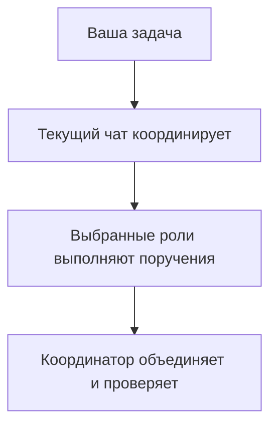

# pNet Plex

[English](README.md) · [Русский](README.ru.md) · [Deutsch](README.de.md) · [简体中文](README.zh-CN.md)

**Соберите команду. Координируйте работу.**

Plex — **agent harness для оркестрации и координации нескольких агентов** в
OpenAI Codex, Anthropic Claude Code и Google Antigravity. Установите готовую команду,
выберите профиль моделей и поручите Plex организовать реализацию, ревью и проверку.

**[v0.5.5](https://github.com/pnetcloud/plex-ai/releases/tag/v0.5.5)** — открытый проект, MIT. Можно пробовать; интерфейсы ещё могут меняться.

## Установка

Запустите в папке проекта:

```sh
curl -fsSL https://raw.githubusercontent.com/pnetcloud/plex-ai/main/install.sh | bash
```

**Dev-режим · Codex · локальные скиллы проекта**

```sh
curl -fsSL https://raw.githubusercontent.com/pnetcloud/plex-ai/main/install.sh | bash -s -- --dev --client codex
```

Выберите клиентов, область, команду и профиль моделей; подтвердите план. Рекомендуется область **Project**. После установки откройте новую сессию клиента.

Обычный установщик делает обе части настройки:

- **Общий плагин** — переиспользуемые скиллы `plex` и `plex-setup` для клиента.
- **Команда** — нативные роли агентов и управляемый блок инструкций на уровне проекта или пользователя.

Один плагин ещё не настраивает команду. В dev-режиме используются ссылки на локальные скиллы вместо общего плагина Plex в этом проекте.

[Требования, BMad, dev-режим и все параметры](readme/translations/ru/installation.md).

## Как это работает

Текущий чат остаётся координатором и сохраняет свою модель. Он делегирует полезные поручения, объединяет результаты и проверяет итог. Небольшие задачи могут выполняться локально.



## Примеры в чате

Это **запросы в чате, а не команды терминала**. Замените плейсхолдеры в угловых скобках перед отправкой.

**Скоординировать задачу · плагин Codex**

```text
$pnet-plex:plex Скоординируй <задачу>. Требования: <требования>. Проверь <критерии приёмки>.
```

**Провести ревью изменений**

```text
$pnet-plex:plex Проведи ревью <изменений> по <требованиям>. Укажи замечания и пробелы в проверках.
```

**Проверить или настроить команду**

```text
$pnet-plex:plex-setup Проверь конфигурацию Plex в этом проекте.
$pnet-plex:plex-setup Настрой проект: команда <команда>, профиль <профиль>, взаимодействие <режим>.
```

**Координация задачи · плагин Claude Code**

```text
/pnet-plex:plex Выполни <задачу>. Требования: <требования>. Проверь <критерии приёмки>.
/pnet-plex:plex-setup Проверь конфигурацию Plex в этом проекте.
```

В режиме Codex `--dev` используйте локальные `$plex` и `$plex-setup`. В других клиентах выберите установленный скилл или явно попросите: `Используй Plex для координации <задачи>.`

Установка не запускает координацию автоматически. `plex-setup` меняет конфигурацию, `plex` координирует работу.

## Команды и модели

| Команда | Назначение |
|---|---|
| **pnet** | Обычная разработка: PM, explorer, researcher, dev, reviewer и QA; BMad не требуется |
| **bmad** | Установленные персоны и workflow BMad; установщик предлагает выбранные зависимости и инициализацию проекта |

Профили **Inherit, Basic, Plus, Pro, Pro+** задают модели субагентов. Модель основного чата выбираете вы; установщик показывает рекомендацию выбранного профиля. См. [конфигурацию](docs/translations/ru/configuration.md).

## Команды терминала

| Задача | Команда |
|---|---|
| Настроить или обновить конфигурацию проекта | `plex` |
| Проверить установку | `plex status` |
| Скачать обновление и открыть настройку | `plex update` |
| Посмотреть план удаления команды | `plex uninstall --dry-run` |
| Удалить команду из этого проекта | `plex uninstall` |

Если необязательной команды `plex` нет, используйте `~/.local/share/plex-ai/setup.sh`. В установщике **Update only** сохраняет настройки, **Reconfigure** открывает меню.

## Удаление

Запустите `plex uninstall` из папки проекта. Команда удалит неизменённые управляемые роли, блок Plex и принадлежащие ему dev-ссылки; окружающие инструкции сохранятся. Настройки, резервные копии и общий плагин останутся.

Чтобы также удалить общий **плагин Codex**, когда другие проекты больше в нём не нуждаются:

```sh
codex plugin remove pnet-plex@pnet-plex
```

Другие клиенты и удаление команды уровня пользователя описаны в [руководстве](readme/translations/ru/installation.md#удаление).

## Подробнее

- [Сообщить о проблеме](https://github.com/pnetcloud/plex-ai/issues).
- [Документация](docs/translations/ru/README.md) — подробности настройки и использования.
- [О Plex](docs/translations/ru/product.md) — назначение и принципы.
- [Совместимость](docs/translations/ru/host-compatibility.md) — живые тесты Codex и отдельных конфигураций Antigravity; нативный Claude Code пока не проверен на живых задачах.
- [Тестирование и эффективность](docs/translations/ru/testing.md) — методика, измерения токенов/стоимости и субъективная оценка качества.
- [Архитектура](docs/translations/ru/architecture.md) — как связаны конфигурация и координация.

## Лицензия

[MIT](LICENSE). Инструкции агентов адаптированы с опорой на [Awesome Codex Subagents](https://github.com/VoltAgent/awesome-codex-subagents);
см. [сторонние материалы](THIRD_PARTY_NOTICES.md).
