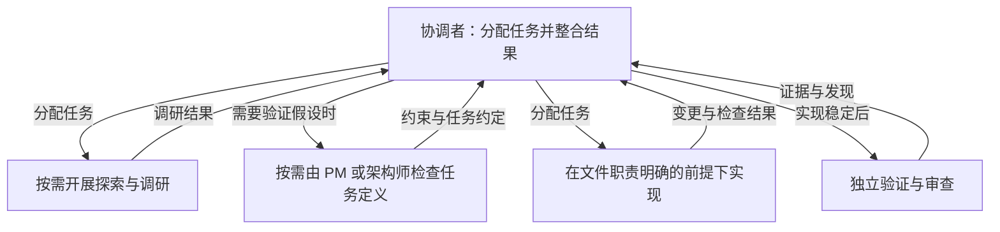

# pNet Plex

[English](README.md) · [Русский](README.ru.md) · [Deutsch](README.de.md) · [简体中文](README.zh-CN.md)

**组建你的团队，协调每一步工作。**

pNet Plex 是面向软件开发的 **Agent Harness，用于多智能体编排与协调
（multi-agent orchestration and coordination）**。你可以定义专业角色、选择模型，
并在已有的智能体编程工具中，将规划、实现和审查串联起来。

一个能力出色的智能体可以独立完成很多工作。团队协作则带来了新的问题：
每项任务由谁负责，需要哪些上下文，使用什么模型，以及如何验证结果。
Plex 通过项目级团队配置和协调技能（skills），让这些决策清晰可见。

## 为什么叫 Plex？

这个名字源于 *multiplex*：通过一个共享系统汇聚多个信息流。
在 Plex 中，这些信息流就是各个专业智能体为共同目标做出的贡献。
每个角色都有明确的职责，协调者负责整合各方的工作。

## 智能体编排、协调与 Agent Harness

- **编排（Orchestration）**组织工作流程：选择合适的角色，委派范围明确的任务，
  遵循依赖关系，并收集结果以进行整合。
- **协调（Coordination）**让团队保持一致：共享相关上下文，明确文件修改职责，
  暴露阻塞问题，并安排独立审查。
- **Agent Harness** 提供可复用的支撑机制：项目配置、可复用技能、模型配置方案，
  以及针对各智能体运行环境的原生角色定义。

当前运行的智能体担任协调者。Plex 遵循所在运行环境的执行机制和权限规则，
无需独立的后台服务或界面。如果输入条件和文件职责划分允许，独立任务可以并行执行。
小任务可以使用小团队；委派工作应当有实际价值。

## 重点平台

Plex 专注于三个智能体生态：

| 平台 | Plex 集成状态 |
| --- | --- |
| **OpenAI Codex** | 已实现；已有隔离环境下的安装与配置检查 |
| **Anthropic Claude Code** | 已实现原生角色生成；实际执行仍需验证 |
| **Google Antigravity** 与 **Gemini 模型** | 开发中；已有模板和 Google 模型配置，端到端支持尚未验证 |

以上是产品当前的重点。其他运行环境暂未列入路线图。
运行环境与模型是两个独立的选择：提供某个模型的配置，并不意味着支持另一个运行环境。
Gemini CLI 是独立的运行环境，目前不在集成范围内。

## 你的团队，你的模型

可以先使用 **default** 团队：PM 负责调研与规划，dev 负责实现与测试，
reviewer 独立审查结果。选择 **BMad**，则可以使用更完整的角色组合，
配合已安装的 BMad 技能和工作流。default 团队无需依赖 BMad。

团队组成与模型选择相互独立。选择模型配置方案，调整各角色的设置，
并将这些选择保存在项目中。Plex 创建项目原生角色，帮助协调者将它们用于当前任务。

质量、速度和成本的改善需要通过测量来确认；增加智能体数量本身并不代表结果会更好。

## 工作方式

协调者只从已配置的团队中选择当前需要的角色。清晰且范围明确的任务可以直接进入实现。
当任务范围、验收标准或技术不变量需要确认时，再引入 PM 或架构师。
如果输入条件和文件职责划分允许，调研与审查可以并行进行。

在 BMad 模式下，包装层会激活实际安装的技能，并遵循该版本的工作流与自定义配置。
它不会将菜单命令或步骤顺序写死，也会保留需要人工决策的环节。
图中的箭头表示任务分配和结果返回；只有运行环境与任务交接约定明确授权时，
子智能体才可以继续委派任务。

## 发布状态

这个早期开发预览版包含 `plex` 和 `plex-setup` 技能、基于本地仓库副本的安装程序
（`setup.py` / `setup.sh`）、团队预设、模型配置方案以及原生插件清单。
完整文档和测试暂未包含在本次发布中。实际任务委派和模型路由仍需在各运行环境中验证；
这不是稳定版本。

## 许可证

pNet Plex 采用 [MIT 许可证](LICENSE)。
