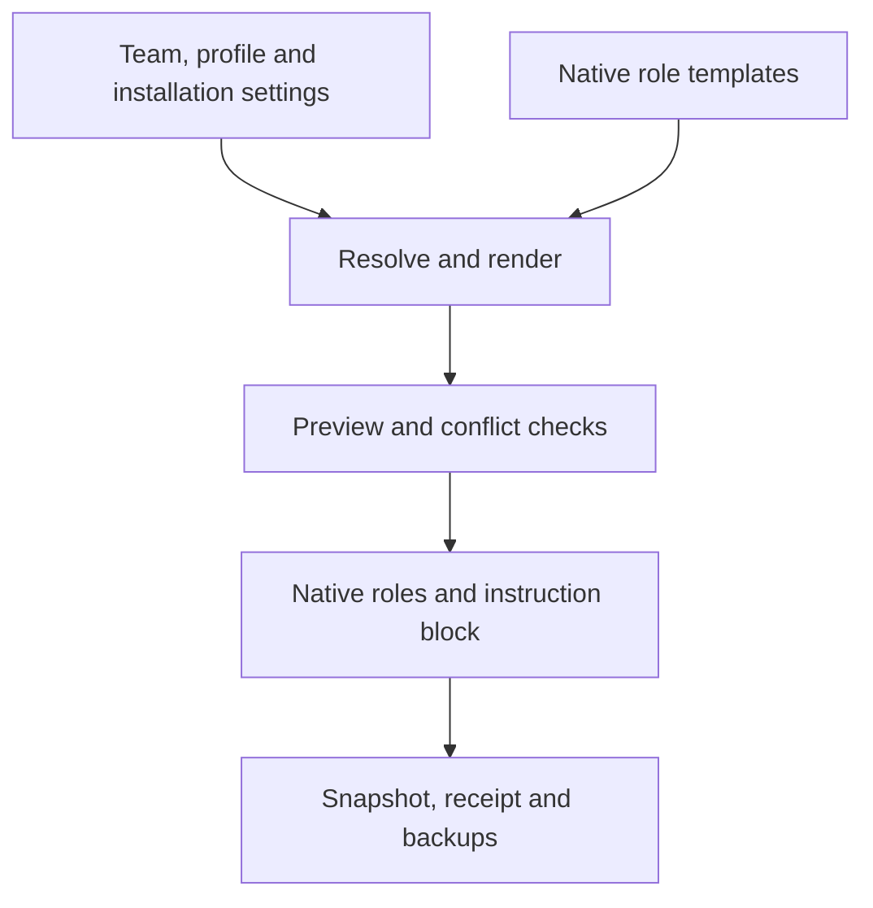

# Architecture

[English](architecture.md) · [Русский](translations/ru/architecture.md) · [Deutsch](translations/de/architecture.md) · [简体中文](translations/zh-CN/architecture.md)

## Configuration pipeline

`resolve_config.py` is the single Python standard-library implementation of
resolution, rendering, checking and application. The checkout installer uses this
pipeline rather than maintaining separate merge rules.

`resolve` computes effective settings; `render` produces native role content in
memory; `check` compares desired state, receipts and files; `apply` writes selected
client state after conflict checks. Project and user scope use the same pipeline.
See [configuration](configuration.md) for paths, precedence and ownership.

Plugin installation supplies reusable skills and team resources. Role application
materializes the selected native agents and manages only a marked instruction block.
The plugin source/export and the target project's generated files have separate lifecycles.

## Coordination

Explicit `plex` invocation loads its preflight and the selected team's
`coordinator.md`. The current root remains coordinator with its session model and
permissions. The managed instruction block does not activate a team automatically.

The root assigns ready work with outcome, inputs, authority, checks and return
expectations. Writers have exclusive file ownership. Independent work may run in
parallel within the shared assignment limit and native host limits. Role availability
does not require a fixed stage or automatic specialist call.

## BMad workflow ownership

BMad wrappers activate the actual installed skills and resolve their dispatch,
customization and rendered route. An executing workflow owns its required checks
and reviews; Plex does not append another full review automatically.

An early exit ends its current step. The coordinator verifies the reached branch
before relaying a question; genuine unresolved decisions and applicable checkpoints
still wait for the user. A mistaken gate is corrected in the same assignment.

Nested executors preserve the workflow's prompt/context contract and must not
restart workflow-owning wrappers recursively. Their actual models may differ from
standalone Plex roles. Record the active skill source and actual runtime model;
plugin inventory or a model's self-description alone is insufficient.

## Updates and failures

Application uses a lock, pre-write comparisons, atomic file replacement, read-back
hashes and backups. On caught errors, rollback preserves newer concurrent edits
and reports unresolved recovery paths. Native plugin-manager operations are separate.

This is not a crash-proof filesystem transaction: interruption or disk failure can
leave partial state and a lock. Inspect its PID, files, receipt and backups before
recovery; never remove a running apply's lock. Refresh is explicit and does not
change the settings of an already running agent session.
