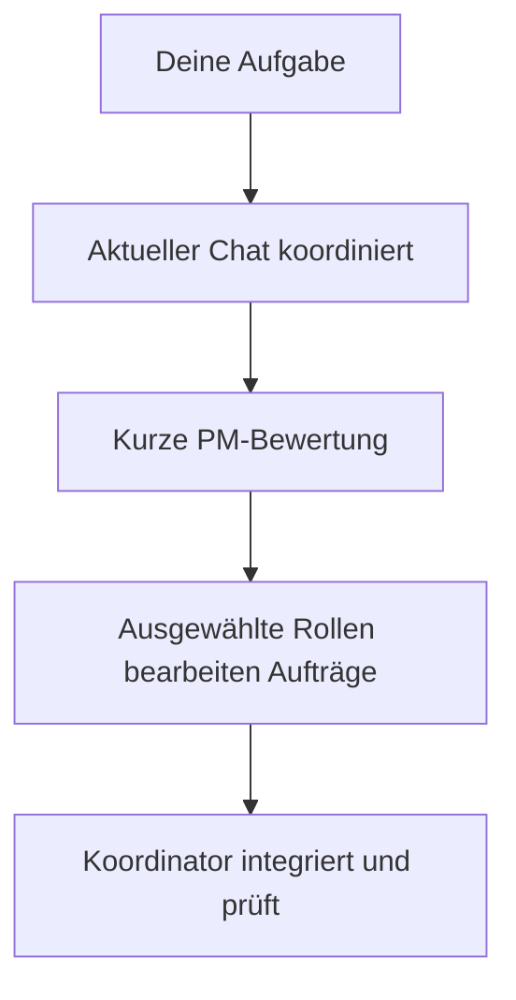

<p align="center">
  
</p>

# Plex AI

[English](../../../README.md) · [Русский](../ru/README.md) · [Deutsch](README.md) · [简体中文](../zh-CN/README.md)

**Team zusammenstellen. Arbeit koordinieren.**

Plex ist ein **Agent Harness für Multi-Agent-Orchestrierung und Koordination** in
OpenAI Codex, Anthropic Claude Code und Google Antigravity. Ein wiederverwendbares
Team installieren, Modellprofil wählen und Plex mit Umsetzung, Review und Prüfung beauftragen.

[](https://github.com/pnetcloud/plex-ai/releases/latest) [](https://github.com/pnetcloud/plex-ai/actions/workflows/ci.yml) [](https://github.com/pnetcloud/plex-ai/blob/main/LICENSE)

**[Installieren](#quickstart)** · **[Funktionsweise](../../../README.md#how-it-works)** · **[Dokumentation](index.md)** · **[Releases](https://github.com/pnetcloud/plex-ai/releases/latest)** · **[Problem melden](https://github.com/pnetcloud/plex-ai/issues)**

**Status: aktive Entwicklung; zur Erprobung verfügbar.** Unterstützung und Prüfungsumfang
unterscheiden sich je Client.

<a id="quickstart"></a>

## Schnellstart

Im Projektverzeichnis ausführen. Erforderlich sind Git, curl, die CLI des gewählten Clients sowie
uv oder Python 3.11+:

```sh
curl -fsSL https://raw.githubusercontent.com/pnetcloud/plex-ai/main/install.sh | bash
```

**Dev-Modus · Codex · projektlokale Skills**

```sh
curl -fsSL https://raw.githubusercontent.com/pnetcloud/plex-ai/main/install.sh | bash -s -- --dev --client codex
```

Clients, Bereich, Team und Modellprofil wählen; den Plan bestätigen. **Project** wird empfohlen. Danach eine neue Client-Sitzung öffnen.

Die normale Installation übernimmt beide Teile:

- **Gemeinsames Plugin** — wiederverwendbare Skills `plex` und `plex-setup` für den Client.
- **Teamkonfiguration** — native Agentenrollen und verwalteter Anweisungsblock auf Projekt- oder Benutzerebene.

Das Plugin allein konfiguriert kein Team. Im Dev-Modus ersetzen lokale Skill-Links das gemeinsame Plex-Plugin in diesem Projekt.

[Voraussetzungen, BMad, Dev-Modus und alle Optionen](installation.md).

## Ablauf

Der aktuelle Chat bleibt Koordinator und behält sein Modell. Jede neue Aufgabe erhält zuerst eine kurze Bewertung durch `plex-pm`. Der Koordinator folgt dieser Route, sammelt notwendige Fachentscheidungen, beauftragt Dev und prüft das Ergebnis. Abgedeckte Schritte verwenden die Bewertung erneut.



## Chat-Beispiele

Dies sind **Chat-Anfragen, keine Terminalbefehle**. Platzhalter in spitzen Klammern vor dem Senden ersetzen.

**Aufgabe koordinieren · Codex-Plugin**

```text
$plex Koordiniere <Aufgabe>. Anforderungen: <Anforderungen>. Prüfe <Abnahmekriterien>.
```

**Änderung prüfen**

```text
$plex Prüfe <Änderung> anhand von <Anforderungen>. Melde Befunde und Prüflücken.
```

**Team prüfen oder konfigurieren**

```text
$plex-setup Prüfe die Plex-Konfiguration dieses Projekts.
$plex-setup Konfiguriere dieses Projekt: Team <Team>, Profil <Profil>, Interaktion <Modus>.
```

**Aufgabe koordinieren · Claude-Code-Plugin**

```text
/pnet-plex:plex Koordiniere <Aufgabe>. Anforderungen: <Anforderungen>. Prüfe <Abnahmekriterien>.
/pnet-plex:plex-setup Prüfe die Plex-Konfiguration dieses Projekts.
```

In Codex gelten `$plex` und `$plex-setup` für Standard- und Dev-Installationen. In anderen Clients den installierten Skill auswählen oder ausdrücklich bitten: `Nutze Plex zur Koordination von <Aufgabe>.`

Installation startet keine Koordination. `plex-setup` konfiguriert; `plex` koordiniert die Arbeit.

## Teams und Modelle

| Team | Zweck |
|---|---|
| **pnet** | Allgemeine Entwicklung: PM, explorer, researcher, dev, reviewer, QA und DevOps; ohne BMad |
| **bmad** | Installierte BMad-Personas und Workflows plus nativer DevOps; Setup bietet ausgewählte Abhängigkeiten und Projektinitialisierung |

**Inherit, Basic, Plus, Pro, Pro+, Ultra und Ultra+** konfigurieren Subagenten. Das Hauptchatmodell wählst du; Setup zeigt eine profilabhängige Empfehlung. Siehe [Konfiguration](configuration.md).

### Modi der Agenten-Orchestrierung

Plex ist ein **AI Agent Orchestrator** in deinem Coding-Client. Dein Chat übernimmt
die **Koordination**: PM formuliert die Aufgabe, spezialisierte Subagenten liefern
Entscheidungen und Entwickler setzen die Arbeit zur Prüfung um. Modellprofile verteilen
Luna, Sol und Astra oder Haiku, Sonnet und Opus auf diese Rollen; der Koordinator behält dein Chatmodell.

Drei unabhängige Einstellungen: **Team** (`pnet` oder BMad-Workflows),
**Modellprofil** (Inherit / Basic / Plus / Pro / Pro+ / Ultra / Ultra+) und **Interaktionsmodus**:

| Modus | Zusammenarbeit mit dem Team |
|---|---|
| **Interactive** | Anforderungen und wesentliche Entscheidungen gemeinsam klären |
| **Balanced** · Standard | Routinefragen selbst lösen; bei wesentlichen offenen Entscheidungen und erforderlichen Freigaben nachfragen |
| **Auto** | Autorisierte Arbeit ohne Warten auf Antworten ausführen; Ergebnisse und Blocker melden |

### Modelle nach Profil

Dies sind **Plex-Konfigurationsprofile**, unabhängig von den Abonnements der Anbieter.
Jede Zelle zeigt **Entwicklung → Code-Review** für das mitgelieferte `pnet`-Team.

| Client / Modellanbieter | Basic | Plus | Pro | Pro+ | Ultra | Ultra+ |
|---|---|---|---|---|---|---|
| OpenAI Codex | Luna → Luna | Luna → Sol | Luna → Sol | Sol → Sol | Sol → Astra | Sol → Astra |
| Claude Code / Anthropic | Haiku → Haiku | Haiku → Sonnet | Haiku → Sonnet | Sonnet → Sonnet | Sonnet → Opus | Sonnet → Opus |
| Antigravity / Google Gemini | `flash` → `flash` | `flash` → `inherit` | `flash` → `inherit` | `inherit` → `inherit` | `inherit` → `inherit` | `inherit` → `inherit` |
| Antigravity / Anthropic | Sonnet low → Sonnet low | Sonnet low → Sonnet medium | Sonnet low → Sonnet high | Sonnet medium → Sonnet high | Sonnet medium → Opus medium | Sonnet high → Opus high |

- **Basic:** ein Basismodell für alle `pnet`-Rollen. **Plus:** getrennte Modelle für Umsetzung und Review, sofern konfiguriert.
- **Pro:** höhere Reasoning-Stufen für ausgewählte Rollen; Modellfamilien können gleich bleiben. **Pro+:** Sol/Sonnet für Entwicklung und Review. **Ultra:** Spezialisten mit Astra/Opus. **Ultra+:** höherer Reasoning-Effort.
- **BMad:** dieselben Entwicklungs-/Review-Paare, aber Basic nutzt für Review bereits Sol, Sonnet, `inherit` beziehungsweise Sonnet medium. Planung, Architektur und weitere Rollen haben eigene Einstellungen.
- **Inherit:** Vorgaben des Clients/der Sitzung. In Gemini-Profilen legt `inherit` kein bestimmtes Gemini-Pro-Modell fest.

Konfigurierte IDs: Luna = `gpt-6-luna`, Sol = `gpt-6.1-sol`, Astra = `gpt-6-astra`.
Claude Code nutzt die Aliase `haiku`, `sonnet`, `opus`; die Anthropic-Profile in Antigravity verwenden
`claude-sonnet-5-5-{low,medium,high}` und `claude-opus-5-5-{low,medium,high}`.
Dies sind mitgelieferte Einstellungen, keine Garantie für Modellverfügbarkeit oder Einsparungen. Setup zeigt die wirksamen Einstellungen einschließlich Projektüberschreibungen.

[Alle pnet-Rollen](../../../teams/pnet/profiles/) · [Alle BMad-Rollen](../../../teams/bmad/profiles/) · [Profilkonfiguration](configuration.md)

## Terminalbefehle

| Aufgabe | Befehl |
|---|---|
| Projekt konfigurieren oder auffrischen | `plex` |
| Installation prüfen | `plex status` |
| Update herunterladen und Setup öffnen | `plex update` |
| Teamentfernung vorab anzeigen | `plex uninstall --dry-run` |
| Team dieses Projekts entfernen | `plex uninstall` |

Fehlt der optionale Befehl `plex`, stattdessen `~/.local/share/plex-ai/setup.sh` verwenden. **Update only** behält Einstellungen; **Reconfigure** öffnet die Menüs.

## Deinstallation

`plex uninstall` im Projektverzeichnis ausführen. Unveränderte verwaltete Rollen, der Plex-Anweisungsblock und Skill-Links und Dev-Overrides werden entfernt; umgebende Anweisungen bleiben erhalten. Einstellungen, Backups und das gemeinsame Plugin bleiben bestehen.

Das gemeinsame **Codex-Plugin** ebenfalls entfernen, sobald andere Projekte es nicht mehr benötigen:

```sh
codex plugin remove pnet-plex@pnet-plex
```

Andere Clients und benutzerweite Teams: siehe [Deinstallation](installation.md#deinstallation).

## Weiterführend

- [Problem melden](https://github.com/pnetcloud/plex-ai/issues).
- [Dokumentation](index.md) — Einrichtung und Nutzung.
- [Mitwirken](../../../CONTRIBUTING.md).
- [Über Plex](product.md) — Zweck und Prinzipien.
- [Kompatibilität](host-compatibility.md) — Live-Tests für Codex und ausgewählte Antigravity-Konfigurationen; native Claude-Code-Aufgaben noch ungeprüft.
- [Tests und Effizienz](testing.md) — Methodik, Token-/Kostenmessungen und subjektive Qualitätsbewertung.
- [Architektur](architecture.md) — Zusammenspiel von Konfiguration und Koordination.

## Lizenz

[MIT](../../../LICENSE). Agentenanweisungen adaptieren [Awesome Codex Subagents](https://github.com/VoltAgent/awesome-codex-subagents);
siehe [Drittanbieterhinweise](../../../THIRD_PARTY_NOTICES.md).
