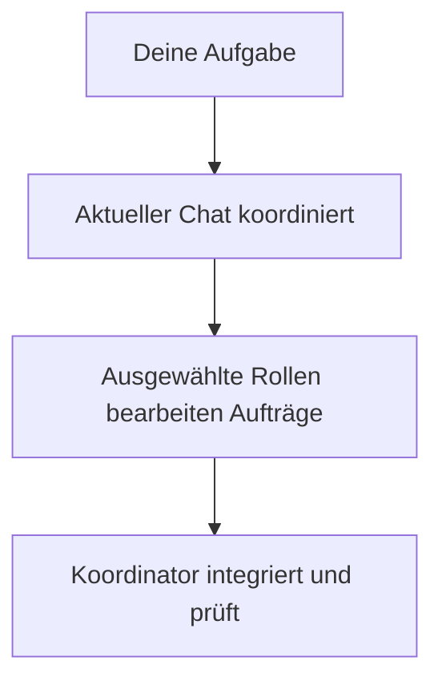

# pNet Plex

[English](../../../README.md) · [Русский](../ru/README.md) · [Deutsch](README.md) · [简体中文](../zh-CN/README.md)

**Team zusammenstellen. Arbeit koordinieren.**

Plex ist ein **Agent Harness für Multi-Agent-Orchestrierung und Koordination** in
OpenAI Codex, Anthropic Claude Code und Google Antigravity. Ein wiederverwendbares
Team installieren, Modellprofil wählen und Plex mit Umsetzung, Review und Prüfung beauftragen.

**[v0.5.11](https://github.com/pnetcloud/plex-ai/releases/tag/v0.5.11)** — Open Source, MIT. Zum Ausprobieren; Schnittstellen können sich ändern.

## Installation

Im Projektverzeichnis ausführen:

```sh
curl -fsSL https://raw.githubusercontent.com/pnetcloud/plex-ai/main/install.sh | bash
```

**Dev-Modus · Codex · projektlokale Skills**

```sh
curl -fsSL https://raw.githubusercontent.com/pnetcloud/plex-ai/main/install.sh | bash -s -- --dev --client codex
```

Clients, Bereich, Team und Modellprofil wählen; den Plan bestätigen. **Project** wird empfohlen. Danach eine neue Client-Sitzung öffnen.

Die normale Installation übernimmt beide Teile:

- **Gemeinsames Plugin** — wiederverwendbare Skills `plex` und `plex-setup` für den Client.
- **Teamkonfiguration** — native Agentenrollen und verwalteter Anweisungsblock auf Projekt- oder Benutzerebene.

Das Plugin allein konfiguriert kein Team. Im Dev-Modus ersetzen lokale Skill-Links das gemeinsame Plex-Plugin in diesem Projekt.

[Voraussetzungen, BMad, Dev-Modus und alle Optionen](installation.md).

## Ablauf

Der aktuelle Chat bleibt Koordinator und behält sein Modell. Er delegiert sinnvolle Aufträge, integriert Ergebnisse und prüft das Resultat. Kleine Aufgaben können lokal bleiben.



## Chat-Beispiele

Dies sind **Chat-Anfragen, keine Terminalbefehle**. Platzhalter in spitzen Klammern vor dem Senden ersetzen.

**Aufgabe koordinieren · Codex-Plugin**

```text
$plex Koordiniere <Aufgabe>. Anforderungen: <Anforderungen>. Prüfe <Abnahmekriterien>.
```

**Änderung prüfen**

```text
$plex Prüfe <Änderung> anhand von <Anforderungen>. Melde Befunde und Prüflücken.
```

**Team prüfen oder konfigurieren**

```text
$plex-setup Prüfe die Plex-Konfiguration dieses Projekts.
$plex-setup Konfiguriere dieses Projekt: Team <Team>, Profil <Profil>, Interaktion <Modus>.
```

**Aufgabe koordinieren · Claude-Code-Plugin**

```text
/pnet-plex:plex Koordiniere <Aufgabe>. Anforderungen: <Anforderungen>. Prüfe <Abnahmekriterien>.
/pnet-plex:plex-setup Prüfe die Plex-Konfiguration dieses Projekts.
```

In Codex gelten `$plex` und `$plex-setup` für Standard- und Dev-Installationen. In anderen Clients den installierten Skill auswählen oder ausdrücklich bitten: `Nutze Plex zur Koordination von <Aufgabe>.`

Installation startet keine Koordination. `plex-setup` konfiguriert; `plex` koordiniert die Arbeit.

## Teams und Modelle

| Team | Zweck |
|---|---|
| **pnet** | Allgemeine Entwicklung: PM, explorer, researcher, dev, reviewer und QA; ohne BMad |
| **bmad** | Installierte BMad-Personas und Workflows; Setup bietet ausgewählte Abhängigkeiten und Projektinitialisierung |

**Inherit, Basic, Plus, Pro und Pro+** konfigurieren Subagenten. Das Hauptchatmodell wählst du; Setup zeigt eine profilabhängige Empfehlung. Siehe [Konfiguration](configuration.md).

## Terminalbefehle

| Aufgabe | Befehl |
|---|---|
| Projekt konfigurieren oder auffrischen | `plex` |
| Installation prüfen | `plex status` |
| Update herunterladen und Setup öffnen | `plex update` |
| Teamentfernung vorab anzeigen | `plex uninstall --dry-run` |
| Team dieses Projekts entfernen | `plex uninstall` |

Fehlt der optionale Befehl `plex`, stattdessen `~/.local/share/plex-ai/setup.sh` verwenden. **Update only** behält Einstellungen; **Reconfigure** öffnet die Menüs.

## Deinstallation

`plex uninstall` im Projektverzeichnis ausführen. Unveränderte verwaltete Rollen, der Plex-Anweisungsblock und Skill-Links und Dev-Overrides werden entfernt; umgebende Anweisungen bleiben erhalten. Einstellungen, Backups und das gemeinsame Plugin bleiben bestehen.

Das gemeinsame **Codex-Plugin** ebenfalls entfernen, sobald andere Projekte es nicht mehr benötigen:

```sh
codex plugin remove pnet-plex@pnet-plex
```

Andere Clients und benutzerweite Teams: siehe [Deinstallation](installation.md#deinstallation).

## Weiterführend

- [Problem melden](https://github.com/pnetcloud/plex-ai/issues).
- [Dokumentation](index.md) — Einrichtung und Nutzung.
- [Mitwirken](../../../CONTRIBUTING.md).
- [Über Plex](product.md) — Zweck und Prinzipien.
- [Kompatibilität](host-compatibility.md) — Live-Tests für Codex und ausgewählte Antigravity-Konfigurationen; native Claude-Code-Aufgaben noch ungeprüft.
- [Tests und Effizienz](testing.md) — Methodik, Token-/Kostenmessungen und subjektive Qualitätsbewertung.
- [Architektur](architecture.md) — Zusammenspiel von Konfiguration und Koordination.

## Lizenz

[MIT](../../../LICENSE). Agentenanweisungen adaptieren [Awesome Codex Subagents](https://github.com/VoltAgent/awesome-codex-subagents);
siehe [Drittanbieterhinweise](../../../THIRD_PARTY_NOTICES.md).
