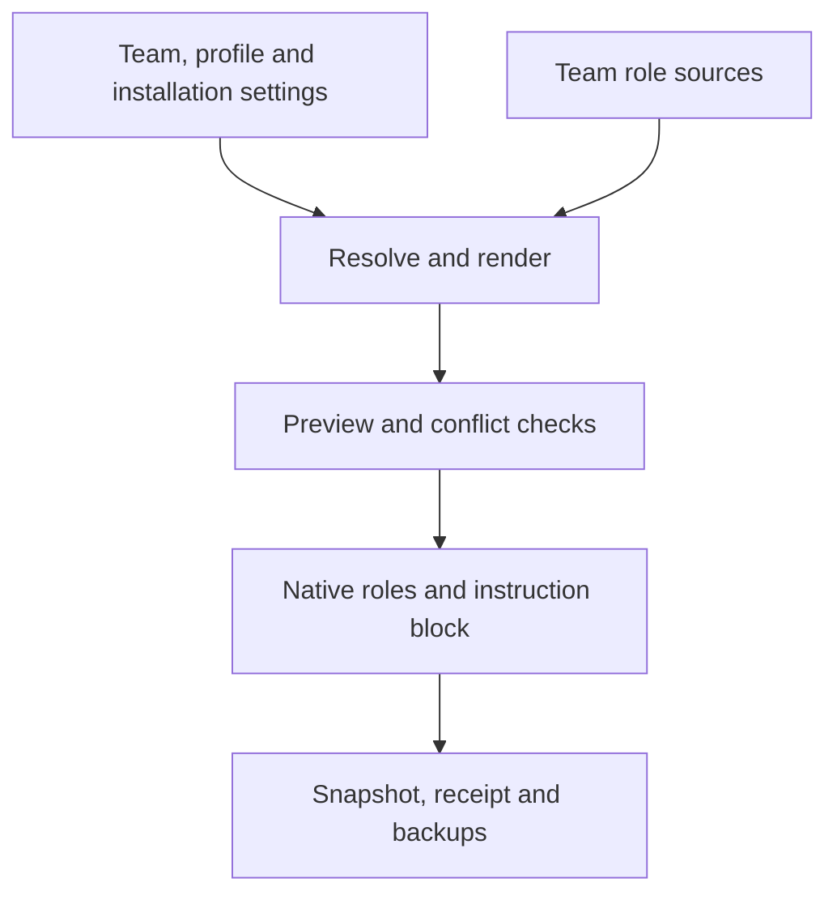

# Architektur

[English](../../architecture.md) · [Русский](../ru/architecture.md) · [Deutsch](architecture.md) · [简体中文](../zh-CN/architecture.md)

## Konfigurationspipeline

`resolve_config.py` implementiert Auflösung, Rendering, Prüfung und Anwendung mit der
Python-Standardbibliothek. Der Installer verwendet dieselbe Pipeline ohne eigene
Merge-Regeln. `resolve` berechnet Werte; `render` erzeugt Rollen im Speicher;
`check` vergleicht Zustand, Receipts und Dateien; `apply` schreibt nach Konfliktprüfung.
Projekt- und Benutzerbereich verwenden dieselbe Pipeline.
Pfade, Prioritäten und Besitzregeln stehen unter [Konfiguration](configuration.md).

Plugins liefern wiederverwendbare Skills und Teamressourcen. Anwendung erzeugt native
Rollen und verwaltet nur einen markierten Anweisungsblock. Pluginexport und generierte
Projektdateien haben getrennte Lebenszyklen.

## Koordination

Explizites `plex` lädt Preflight und `coordinator.md` des Teams. Der aktuelle Root-Agent
bleibt Koordinator mit seinen Sitzungsmodellen und Berechtigungen. Der verwaltete Block
aktiviert das Team nicht automatisch.

Root vergibt ausführbare Aufträge mit Ergebnis, Eingaben, Befugnissen, Prüfungen und
Rückgabevertrag. Pro geänderter Datei gibt es einen Schreiber. Unabhängige Arbeit darf
innerhalb gemeinsamer und nativer Limits parallel laufen. Rollenverfügbarkeit verlangt
weder feste Stufen noch automatische Spezialistenaufrufe.

## BMad-Workflow-Verantwortung

Wrapper aktivieren tatsächlich installierte Skills und bestimmen Dispatch, Anpassungen
und gerenderte Route. Der ausführende Workflow besitzt seine Pflichtprüfungen/Reviews;
Plex hängt nicht automatisch ein zweites vollständiges Review an.

Ein früher Ausstieg beendet den aktuellen Schritt. Der Koordinator prüft die erreichte
Verzweigung vor einer Frage; echte offene Entscheidungen und anwendbare Checkpoints
warten weiterhin auf den Benutzer. Ein falsches Gate wird im selben Auftrag korrigiert.

Verschachtelte Ausführer bewahren Prompt- und Kontextvertrag, ohne Workflow-Wrapper
rekursiv neu zu starten. Ihre Modelle können von eigenständigen Plex-Rollen abweichen.
Aktive Skillquelle und tatsächliches Modell aufzeichnen; Plugininventar und
Modellselbstauskunft allein reichen nicht aus.

## Updates und Fehler

Anwendung nutzt Sperren, Vergleiche vor dem Schreiben, atomaren Dateiersatz, Hashprüfung
und Backups. Rollback bei abgefangenen Fehlern bewahrt neuere parallele Änderungen
und meldet verbleibende Wiederherstellungspfade. Pluginmanager-Vorgänge sind separat.

Dies ist keine absturzsichere Dateisystemtransaktion: Unterbrechung oder Plattenfehler
können Teilzustände und Locks hinterlassen. PID, Dateien, Receipt und Backups vor
Wiederherstellung prüfen; nie den Lock eines laufenden Apply löschen. Refresh ist
explizit und ändert keine bereits laufende Agentensitzung.
