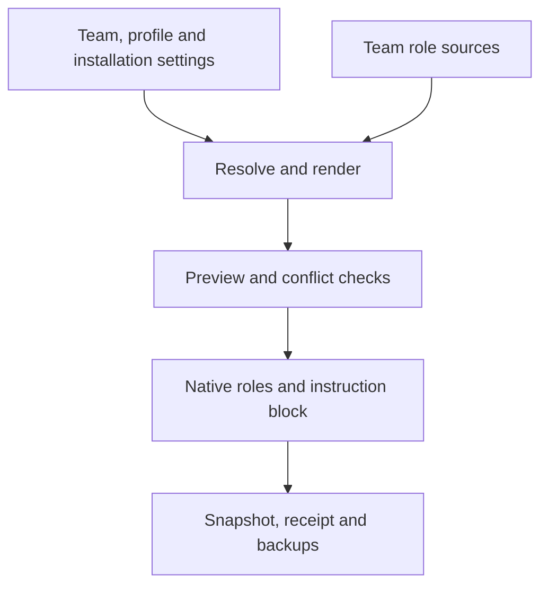

# Архитектура

[English](../../architecture.md) · [Русский](architecture.md) · [Deutsch](../de/architecture.md) · [简体中文](../zh-CN/architecture.md)

## Конвейер конфигурации

`resolve_config.py` — единая реализация разрешения настроек, рендеринга, проверки и
применения на стандартной библиотеке Python. Установщик использует этот же конвейер.
`resolve` вычисляет значения; `render` формирует роли в памяти; `check` сравнивает
настройки, receipts и файлы; `apply` записывает состояние после проверки конфликтов.
Области проекта и пользователя работают одинаково. Пути, приоритеты и владение —
в [конфигурации](configuration.md).

Плагин предоставляет общие скилы и ресурсы команд. Применение создаёт выбранные
нативные роли и управляет только отмеченным блоком инструкций. Экспорт плагина и
сгенерированные файлы проекта имеют отдельные жизненные циклы.

## Координация

Явный вызов `plex` запускает preflight и загружает `coordinator.md` выбранной команды.
Текущий корневой агент сохраняет модель и разрешения своей сессии. Управляемый блок
не активирует команду автоматически.

В начале входного скилла закреплены выбор нативной роли `plex-<role>` и имена
поручений `plex_<role>_<short_task>`. Имя поручения не выбирает роль, а системный
nickname её не определяет. При повторном использовании агент сохраняет идентичность,
но получает актуальную метку задачи для передачи, прогресса и результата. Проверка
конфигурации не доказывает доступность роли в сессии. Неподдерживаемый маршрут
сообщается явно, без молчаливой замены универсальным агентом. Инструкции читаются
отдельно; обрезанные части нужно дочитать до делегирования.

Корень выдаёт готовые поручения с результатом, входами, полномочиями, проверками и
ожидаемым возвратом. Каждый изменяемый файл принадлежит одному исполнителю.
Независимые работы могут идти параллельно в пределах общего и нативных лимитов.
Координатор может сначала записать отложенный запрос в [состояние сессии](../../../skills/plex/references/coordinator-state.md);
PM intake нужен до маршрутизации или исполнения. PM/PO выбирает подход и дальнейшие роли;
root проверяет короткий контракт до вызова. Native Plan/Goal необязательны.
См. [контракты ролей](role-contracts.md).

## Владение workflow BMad

Обёртки активируют реальные установленные скилы и определяют dispatch, customization
и отрендеренный маршрут. Исполняющий workflow владеет обязательными проверками и
ревью; Plex не добавляет второе полное ревью автоматически.
Перед передачей BMad-работы координатор отдельно читает
[контракт исполнения workflow](../../../teams/bmad/workflow-contract.md), сохраняя проектные адаптеры.

Ранний переход завершает текущий шаг. Перед вопросом координатор проверяет ветку;
реальные неопределённости и применимые checkpoint всё равно требуют пользователя.
Ошибочное согласование исправляется в том же поручении.

Вложенные исполнители сохраняют промпт и контракт контекста workflow, без повторного
запуска управляющей обёртки. Их модели могут отличаться от отдельных ролей Plex.
Фиксируйте активный источник скилла и фактическую модель: списка плагинов и самоотчёта
модели недостаточно.

## Обновление и сбои

Применение использует блокировку, сравнения перед записью, атомарную замену, проверку
хешей и резервные копии. Откат при перехваченной ошибке сохраняет новые параллельные
изменения и сообщает пути восстановления. Операции менеджера плагинов отдельны.

Это не транзакция, защищённая от аварий: прерывание или сбой диска могут оставить
частичное состояние и lock. Проверьте PID, файлы, receipt и копии перед восстановлением;
не удаляйте lock работающего apply. Обновление явно и не меняет запущенную сессию агента.
