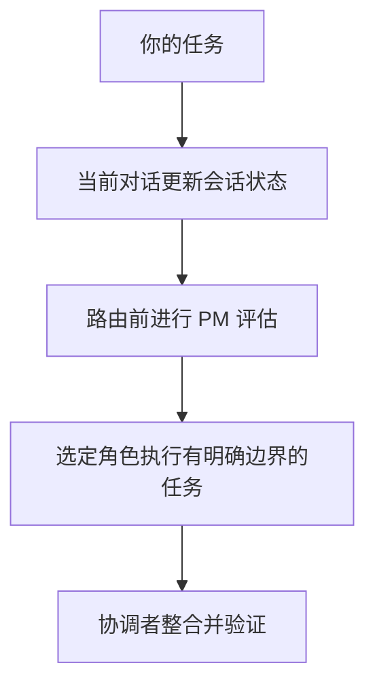

<p align="center">
  
</p>

# Plex AI

[English](../../../README.md) · [Русский](../ru/README.md) · [Deutsch](../de/README.md) · [简体中文](README.md)

**组建团队，协调工作。**

Plex 是用于 **多智能体编排与协调的 agent harness**，集成 OpenAI Codex、Anthropic Claude Code
和 Google Antigravity。安装可复用团队，选择模型配置档，再让 Plex 组织实现、审查和验证。

[](https://github.com/pnetcloud/plex-ai/releases/latest) [](https://github.com/pnetcloud/plex-ai/actions/workflows/ci.yml) [](https://github.com/pnetcloud/plex-ai/blob/main/LICENSE)

**[安装](#quickstart)** · **[工作原理](../../../README.md#how-it-works)** · **[文档](index.md)** · **[版本](https://github.com/pnetcloud/plex-ai/releases/latest)** · **[报告问题](https://github.com/pnetcloud/plex-ai/issues)**

**状态：积极开发中；当前版本可供评估。** 各客户端的支持范围和验证覆盖度有所不同。

<a id="quickstart"></a>

## 快速开始

在项目目录中运行。需要 Git、curl、所选客户端的 CLI，以及 uv 或 Python 3.11+：

```sh
curl -fsSL https://raw.githubusercontent.com/pnetcloud/plex-ai/main/install.sh | bash
```

**开发模式 · Codex · 项目本地技能**

```sh
curl -fsSL https://raw.githubusercontent.com/pnetcloud/plex-ai/main/install.sh | bash -s -- --dev --client codex
```

选择客户端、范围、团队和模型配置档，然后确认计划。推荐 **Project** 范围。安装后打开新的客户端会话。

常规安装器会完成两部分配置：

- **共享插件** — 为客户端提供可复用的 `plex` 和 `plex-setup` 技能。
- **团队配置** — 在项目或用户范围创建原生智能体角色和托管指令块。

只安装插件并不会配置团队。开发模式在该项目中使用本地技能链接代替共享 Plex 插件。

[环境要求、BMad、开发模式及全部参数](installation.md)。

## 工作方式

当前对话继续担任协调者并保留其模型。相关 followup 会更新现有工作；无关请求可先记录为待处理而不派发。路由或执行待处理工作前，必须由 `plex-pm` 简短评估。协调者按路线安排专家决策，再交给 dev 实现并验证。已覆盖的步骤复用已有评估。



## 对话示例

以下是**对话请求，不是终端命令**。发送前替换尖括号中的占位符。

**协调任务 · Codex 插件**

```text
$plex 协调<任务>。要求：<需求>。验证<验收标准>。
```

**审查变更**

```text
$plex 根据<需求>审查<变更>，报告问题和验证缺口。
```

**检查或配置团队**

```text
$plex-setup 检查当前项目的 Plex 配置。
$plex-setup 配置当前项目：团队<团队>、模型配置档<配置档>、交互模式<模式>。
```

**协调任务 · Claude Code 插件**

```text
/pnet-plex:plex 协调<任务>。要求：<要求>。验证<验收标准>。
/pnet-plex:plex-setup 检查此项目的 Plex 配置。
```

Codex 的标准安装和开发安装均使用 `$plex` 和 `$plex-setup`。其他客户端可选择已安装技能，或明确请求：`使用 Plex 协调<任务>。`

安装不会自动启动协调。`plex-setup` 修改配置，`plex` 协调工作。

## 团队与模型

| 团队 | 用途 |
|---|---|
| **pnet** | 通用开发：PM、explorer、researcher、dev、reviewer、QA 和 DevOps；无需 BMad |
| **bmad** | 已安装的 BMad 角色和工作流，以及原生 DevOps；安装器提供所选依赖安装和项目初始化 |

**Inherit、Basic、Plus、Pro、Pro+、Ultra、Ultra+** 配置子智能体。主对话模型由你选择；安装器显示所选配置档的建议。参见[配置](configuration.md)。

### 智能体编排模式

Plex 是编码客户端内的 **AI 智能体编排器（AI agent orchestrator）**。
当前对话充当**协调器（coordinator）**：PM 明确任务，专业子智能体提供决策，
开发智能体完成实现并交由审查。模型配置档将 Luna、Sol、Astra 或 Haiku、Sonnet、Opus
分配给这些角色；协调器保留当前对话的模型。

三个独立设置：**团队**（`pnet` 或 BMad 工作流）、
**模型配置档**（Inherit / Basic / Plus / Pro / Pro+ / Ultra / Ultra+）和**交互模式**：

| 模式 | 团队如何与你协作 |
|---|---|
| **Interactive** | 共同澄清需求和重要决策 |
| **Balanced** · 默认 | 自行处理常规选择；对尚未解决的重要决策和必要确认进行询问 |
| **Auto** | 无需等待回答，执行已授权的工作；返回结果与阻碍因素 |

### 各配置档的模型

这些是 **Plex 配置档**，与提供商的订阅套餐无关。
在 `pnet` 和 BMad 团队中，**OpenAI Codex 多智能体编排与协调**推荐使用 **GPT-6.1 Terra**（`gpt-6.1-terra`）作为**协调器模型（coordinator model）**：**Pro — medium**，**Pro+ — high** 推理强度。请在主对话中选择该模型；Plex 不会切换正在运行的对话模型。

每个单元格表示内置 `pnet` 团队的 **开发 → 代码审查**。

| 客户端 / 模型提供商 | Basic | Plus | Pro | Pro+ | Ultra | Ultra+ |
|---|---|---|---|---|---|---|
| OpenAI Codex | Luna → Luna | Luna → Sol | Terra → Sol | Sol → Sol | Sol → Astra | Sol → Astra |
| Claude Code / Anthropic | Haiku → Haiku | Haiku → Sonnet | Haiku → Sonnet | Sonnet → Sonnet | Sonnet → Opus | Sonnet → Opus |
| Antigravity / Google Gemini | `flash` → `flash` | `flash` → `inherit` | `flash` → `inherit` | `inherit` → `inherit` | `inherit` → `inherit` | `inherit` → `inherit` |
| Antigravity / Anthropic | Sonnet low → Sonnet low | Sonnet low → Sonnet medium | Sonnet low → Sonnet high | Sonnet medium → Sonnet high | Sonnet medium → Opus medium | Sonnet high → Opus high |

- **Basic：** `pnet` 各角色使用同一基础模型。**Plus：** 在配置支持时，为实现和审查分配不同模型。
- **Pro：** Codex 开发使用 Terra，其他客户端提高部分角色的推理级别。**Pro+：** Sol/Sonnet 负责开发与审查。**Ultra：** 引入 Astra/Opus 专家。**Ultra+：** 提高推理强度。
- **BMad：** 开发与审查的配对相同，但 Basic 已分别使用 Sol、Sonnet、`inherit` 或 Sonnet medium 进行审查。规划、架构等角色有各自的设置。
- **Inherit：** 使用客户端或会话默认值。Gemini 配置中的 `inherit` 并不固定为某个 Gemini Pro 模型。

配置中的标识符：Luna = `gpt-6-luna`，Terra = `gpt-6.1-terra`，Sol = `gpt-6.1-sol`，Astra = `gpt-6-astra`。
Claude Code 使用 `haiku`、`sonnet`、`opus` 别名；Antigravity 的 Anthropic 配置使用
`claude-sonnet-5-5-{low,medium,high}` 和 `claude-opus-5-5-{low,medium,high}`。
这些是随项目提供的设置，不保证模型可用性或成本节省。安装器会显示包含项目覆盖项的有效配置。

[pnet 的全部角色设置](../../../teams/pnet/profiles/) · [BMad 的全部角色设置](../../../teams/bmad/profiles/) · [配置档设置](configuration.md)

## 终端命令

| 任务 | 命令 |
|---|---|
| 配置或刷新项目 | `plex` |
| 检查安装 | `plex status` |
| 下载更新并打开安装器 | `plex update` |
| 预览团队移除 | `plex uninstall --dry-run` |
| 移除当前项目团队 | `plex uninstall` |

若没有可选的 `plex` 命令，可使用 `~/.local/share/plex-ai/setup.sh`。**Update only** 保留设置；**Reconfigure** 打开配置菜单。

## 卸载

在项目目录运行 `plex uninstall`，移除未被修改的托管角色、Plex 指令块和所属技能链接；保留周围项目指令。偏好设置、备份和共享插件仍保留。

其他项目不再需要共享 **Codex 插件**时，可一并移除：

```sh
codex plugin remove pnet-plex@pnet-plex
```

其他客户端及用户级团队移除方式参见[卸载说明](installation.md#卸载)。

## 更多内容

- [报告问题](https://github.com/pnetcloud/plex-ai/issues).
- [文档](index.md) — 安装与使用详情。
- [参与贡献](../../../CONTRIBUTING.md).
- [关于 Plex](product.md) — 目标和原则。
- [兼容性](host-compatibility.md) — Codex 和部分 Antigravity 配置已有实际测试；原生 Claude Code 任务尚未验证。
- [测试与效率](testing.md) — 方法、token/成本测量和主观质量观察。
- [架构](architecture.md) — 配置与协调如何协作。

## 许可证

[MIT](../../../LICENSE)。智能体指令参考 [Awesome Codex Subagents](https://github.com/VoltAgent/awesome-codex-subagents) 适配；
详见[第三方声明](../../../THIRD_PARTY_NOTICES.md)。
