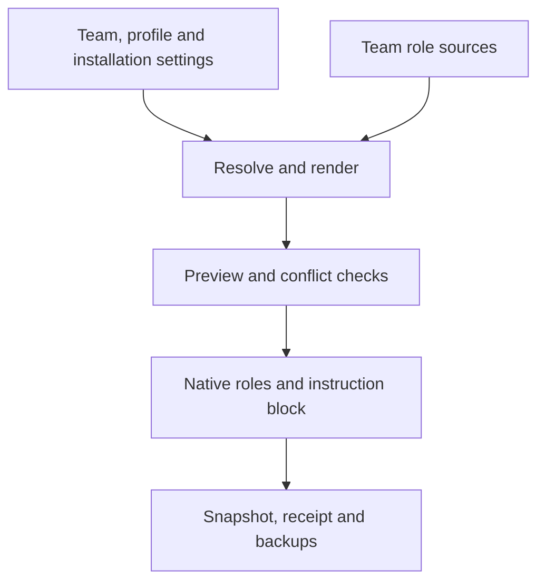

# 架构

[English](../../architecture.md) · [Русский](../ru/architecture.md) · [Deutsch](../de/architecture.md) · [简体中文](architecture.md)

## 配置流程

`resolve_config.py` 使用 Python 标准库实现解析、渲染、检查和应用。
安装器复用同一流程，没有另一套合并规则。`resolve` 计算有效值；`render` 在内存中生成角色；
`check` 比较状态、receipt 和文件；`apply` 检查冲突后写入。
项目和用户范围使用同一流程。路径、优先级和归属规则参见[配置](configuration.md)。

插件分发可复用技能与团队资源；应用操作生成原生角色并管理一个带标记的指令块。
插件导出与项目生成文件具有不同的生命周期。

## 协调

显式调用 `plex` 会读取 preflight 和团队的 `coordinator.md`。
当前根智能体继续担任协调者，保留会话模型和权限；托管指令块不会自动启动团队。

入口技能首先明确原生 `plex-<role>` 的选择和 `plex_<role>_<short_task>` 任务命名。
任务名不会选择角色，运行时昵称也不代表角色。复用智能体时保留其身份，
但在交接、进度和最终返回中使用当前任务标签。配置一致并不证明当前会话可用该角色。
路由不受支持时应明确报告，不得静默改用通用智能体。各指令文档须分开读取，
被截断的部分必须在委派前补读。

根智能体分配可执行任务，注明结果、输入、权限、检查和返回契约。
每个被修改文件只有一位写入责任人。独立工作可在共享和原生限制内并行进行。
每个新任务先由 PM 初评；PM/PO 选择执行方式和后续角色，root 在委派前验证简洁契约。
原生 Plan/Goal 是可选能力。参见[角色契约](role-contracts.md)。

## BMad 工作流职责

包装角色激活实际安装的技能，解析分派、定制和渲染后的执行路线。
执行工作流负责自身必需的检查与审查；Plex 不会自动追加第二轮完整审查。
委派 BMad 工作前，协调者须单独读取[工作流执行契约](../../../teams/bmad/workflow-contract.md)，并保留项目工作流适配器。

提前退出分支会结束当前步骤。协调者应在提问前确认实际到达的分支；
真实的未决事项和适用的用户检查点仍需等待。错误的确认关卡应在当前任务内修正。

嵌套执行者保留提示词和上下文契约，不递归重启工作流包装层。
其模型可能与独立 Plex 角色不同。应记录实际技能来源和实际模型，
仅有插件清单或模型自述不足以证明路由。

## 更新与故障

应用过程使用锁、写前比较、原子文件替换、哈希检查和备份。
捕获异常后的回滚会保留较新的并发修改，并报告剩余恢复路径；插件管理器操作独立处理。

这不是抗崩溃的文件系统事务：中断或磁盘故障可能留下部分状态与锁。
恢复前应检查 PID、文件、receipt 和备份，不能删除正在运行的 apply 的锁。
刷新是显式操作，不会修改已经运行的智能体会话。
