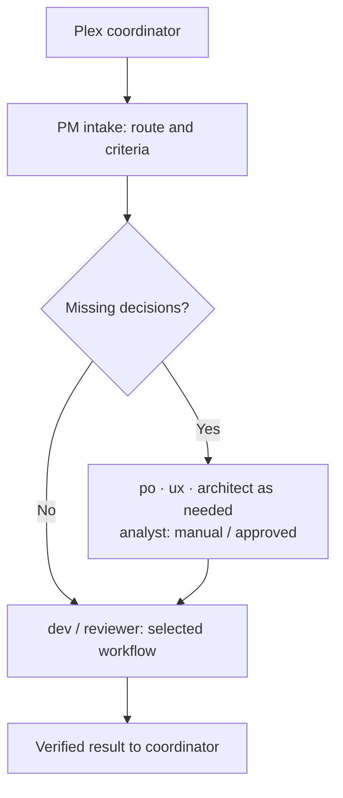

# BMad team: six personas and an independent reviewer

[English](README.md) · [Русский](README.ru.md)

**The coordinator selects a subagent. That subagent runs the appropriate BMad workflow and returns the result.**

Every new task first receives a short `plex-pm` intake assessment, without BMad activation or a PRD. Its route determines subsequent specialist and dev assignments. Use the project's existing task/spec format; required roles cannot be replaced by root.

Six Plex subagents correspond to BMad personas; a seventh, `reviewer`, owns independent code-review workflows. We configure its model,
reasoning and assignment boundaries; BMad supplies the workflow and its procedures.
A task does not need all seven agents. Analyst is manual or explicitly approved only.

## Roles and workflow mapping

The maintained assignment catalog is [team.toml](team.toml): entry skills are in
`[skills]`, workflow descriptions and optional internal menu codes in
`[[workflows.<role>]]`. The resolver copies this catalog to the applied snapshot;
the coordinator selects an operation there and passes it explicitly to the subagent.
Only the selected workflow is loaded; its procedures remain in installed BMad.

| Plex subagent | BMad persona | Assignment | Workflows |
| --- | --- | --- | --- |
| `analyst` | Mary — `bmad-agent-analyst` | Manual or explicitly approved research, option comparison and concept work | `bmad-deep-recon`, `bmad-product-brief`, `bmad-prfaq`, `bmad-brainstorming`; project agent instructions through `bmad-project-context` |
| `pm` | John — `bmad-agent-pm` | Create, update or validate product requirements | `bmad-prd` |
| `po` | Sofia — `bmad-agent-po` | Write specifications, slice work, manage tickets and replan | Internal PO workflows: `SPEC`, `TICKETS`, `REFINE`, `BOARD`, `VALIDATE`, `REPLAN`, `STORE` |
| `ux` | Sally — `bmad-agent-ux-designer` | Define user journeys, interaction states and design | `bmad-ux` |
| `architect` | Winston — `bmad-agent-architect` | Establish architectural decisions, boundaries and invariants | `bmad-architecture` |
| `dev` | Amelia — `bmad-agent-dev` | Implement a change, generate tests or assess a completed epic | `bmad-build`, `bmad-build-auto`, `bmad-qa-generate-e2e-tests`, `bmad-retrospective` |
| `reviewer` | Independent workflow owner | Review an exact diff or PR on its separately configured model | `bmad-code-review` |

The PO entries are **internal workflow codes within one persona**, not separate
skills with those names:

- `SPEC` — ticket requirements and specification from a PRD, brief, notes or other input.
- `TICKETS` — initiatives, epics and story breakdown.
- `REFINE` — create, refine or review one ticket.
- `BOARD` — status, assignment, publication and closure.
- `VALIDATE` — validate a ticket or ticket tree.
- `REPLAN` — assess a change and revise the remaining work.
- `STORE` — configure ticket storage and tracker integration.

The coordinator starts every new Plex task with the matching
[task flow](../../skills/plex/references/task-flows.md), stating the selected roles
and completion check. Missing product decisions go to PM, specifications/tasks to
PO and architectural decisions to architect before implementation. Existing
accepted inputs skip those assignments; a changed assumption brings back only
the relevant specialist. Root owns routing and integration, not all specialist work.

## How work moves

The coordinator supplies the goal, input files and authority. The subagent returns
created or changed artifacts, verification results and unresolved questions.
The next agent receives references to the relevant outputs, not the entire conversation.

For example:

| Request | Route |
| --- | --- |
| “Compare possible approaches” | `analyst` → `bmad-deep-recon`, after explicit approval unless analyst was directly requested |
| “Define the product requirements” | `pm` → `bmad-prd` |
| “Break the requirements into tasks” | `po` → `SPEC`, then `TICKETS` when needed |
| “Implement this ticket” | `dev` → `bmad-build` |
| “Review someone else's PR” | `reviewer` → `bmad-code-review` |
| “Requirements changed; what needs reworking?” | `po` → `REPLAN` |

After PM intake, a small, clear change can go straight to the selected Build workflow. BMad owns its planning,
implementation, review and fixes; the coordinator does not add another mandatory
PM → architect → review → QA sequence around it.

## Execution approach

PM/PO selects normal execution, planning first or bounded work toward a goal. Native
client Plan/Goal modes are optional; unavailable modes do not block ordinary planning or
criteria-driven execution. Use the [assignment
contract](../../skills/plex/references/assignments.md) with one to five observable
criteria, normally three. In `auto`, select installed `bmad-build-auto` for a suitable
unattended assignment: one iteration with mandatory workflow subagents, not a repeating
outer loop. Preserve its renderer and terminal protocol. Otherwise retain an authorized
supported Build route and its actual checkpoints.

## Startup evidence

- Persona role: activate its installed entry skill, then dispatch the operation.
- Reviewer: enter the review workflow directly. Nested workers keep their leaf recipe.
- Report the resolved skill, activation evidence, workflow/operation and reached step.
- The coordinator confirms execution from evidence, not a greeting or role name.
- Build keeps its own investigation and implementation plan, even with upstream planning inputs.

## Analyst authorization

Start analyst only on a direct user request for analyst/Mary or explicit approval
of a bounded analyst assignment. Otherwise explain the question, scope, expected
output, then wait. A coordinator recommendation or a nested
request is not approval. Do not delegate the same research through another persona
to bypass this rule. Small local evidence checks for the current task remain local.

## Models and nested workers

The target Plex profiles configure the seven subagents and, once the adaptation is
implemented, the workers launched inside their workflows. For example: Sol owns
Build, Luna implements the code, and Sol or Astra performs independent review.

A model is selected when a subagent starts. Build's `full` route can hand
implementation to a separate worker; `oneshot` implements in the owner's session.
A nested worker must not restart the entire build or review workflow:
it performs only its assigned BMad task.

The standalone `reviewer` owns the review workflow and uses its own model. Workers
inside that workflow are technical executors, not more personas. Build retains its
own required review; assigning a stronger outer reviewer does not automatically
configure the models of build's nested review workers. QA stays with Amelia. BMad retains control of
human gates, required verification and assignment resumption.

Basic code review now has an explicit role override: Sol / medium for OpenAI,
Sonnet / medium for Claude, and inherit / medium for native Google routing.
Plus/Pro/Pro+ retain their existing dedicated reviewer settings. `inherit` uses the
root session model and does not guarantee an upgrade; the inherit profile remains
fully inherited. Google-Anthropic exact requested IDs retain their existing native
routing limitation.

## Files and implementation status

- [team.toml](team.toml) — registered roles and initial skill bindings.
- [coordinator.md](coordinator.md) — active root coordinator instructions.
- [agents/](agents/) — one Markdown source per role; native client formats are generated during setup.
- [profiles/](profiles/) — models and reasoning settings.

**The seven roles in this mapping are registered in team.toml and have native
instructions and model profiles.** PO follows the PM model/effort settings in the
named tiers. QA is dispatched through dev; reviewer owns standalone code review.
Existing project/user installations require an explicit refresh. The active BMad
installation must provide bmad-agent-po and the selected workflows; a missing
prerequisite blocks execution rather than falling back to an older workflow.

Automatic model assignment to nested workflow workers remains to be implemented.
An outer role's profile does not configure those models by itself.

Nested launches will use the installed BMad version's supported customization
hooks, verified through its official renderer. Do not edit BMad source or plugin
caches. The existing [bmad-build.toml](bmad-build.toml) uses the older review schema
and needs adaptation before applying it to the newer version.

Validate the integration with one build that confirms worker models, plan handoff,
independent review and fix resumption. Measure context and time savings through
comparable live trials.

The mapping follows the menus of the six BMad personas. See the official
[Skills and Agents](https://docs.bmad-method.org/reference/skills-and-agents/),
[Build a Change](https://docs.bmad-method.org/build/build-a-change/) and
[Customize BMad](https://docs.bmad-method.org/customize/customize-bmad/).
