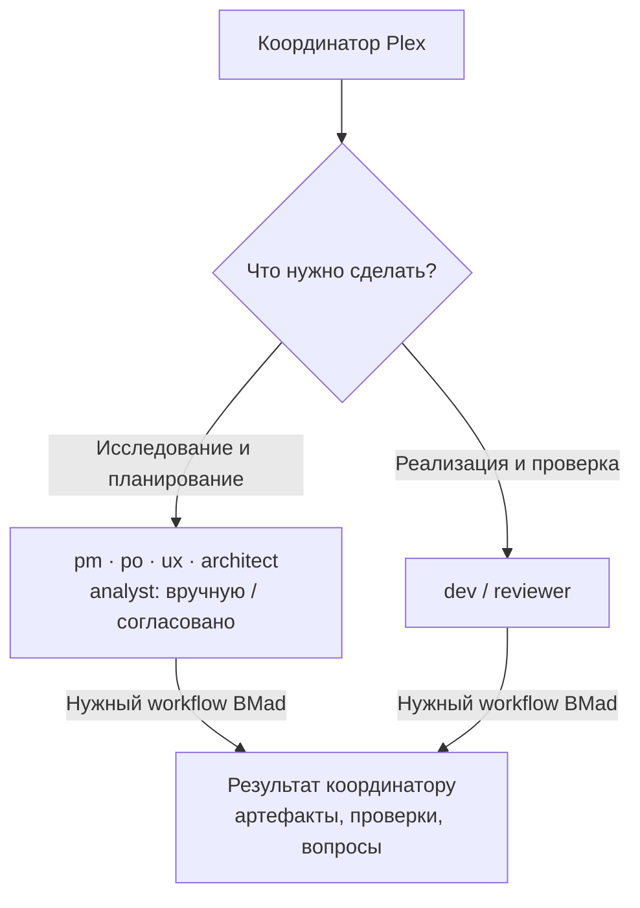

# Команда BMad: шесть персон и независимый reviewer

[English](README.md) · [Русский](README.ru.md)

**Координатор выбирает нужного субагента. Субагент выполняет подходящий workflow BMad и возвращает результат.**

Каждая новая задача сначала получает короткую оценку `plex-pm`, без активации BMad и создания PRD. Она определяет дальнейший маршрут специалистов и dev. Используется принятый формат задачи/spec проекта; root не заменяет обязательные роли.

Шесть наших субагентов соответствуют персонам BMad; седьмой, `reviewer`, отвечает за независимый code review. Мы задаём ему модель,
reasoning и границы задания; порядок работы и содержание workflow берём из BMad.
Не все семь агентов нужны в каждой задаче. Аналитик запускается только вручную или после явного согласования.

## Роли и workflow

Каталог поручений хранится в [team.toml](team.toml): входные skills — в `[skills]`,
описания workflows и необязательные внутренние коды меню — в `[[workflows.<role>]]`.
Резолвер переносит каталог в применённый snapshot; координатор выбирает операцию
из него и явно передаёт субагенту. Загружается только выбранный workflow; его
процедуры остаются в установленном BMad.

| Наш субагент | Персона BMad | Что поручаем | Какие workflow выполняет |
| --- | --- | --- | --- |
| `analyst` | Mary — `bmad-agent-analyst` | По прямому запросу или после согласования исследовать вопрос, сравнить решения, сформулировать концепцию | `bmad-deep-recon`, `bmad-product-brief`, `bmad-prfaq`, `bmad-brainstorming`; инструкции проектным агентам — `bmad-project-context` |
| `pm` | John — `bmad-agent-pm` | Создать, изменить или проверить продуктовые требования | `bmad-prd` |
| `po` | Sofia — `bmad-agent-po` | Написать спецификацию, разбить работу, вести тикеты и перепланировать | Внутренние workflow PO: `SPEC`, `TICKETS`, `REFINE`, `BOARD`, `VALIDATE`, `REPLAN`, `STORE` |
| `ux` | Sally — `bmad-agent-ux-designer` | Описать пользовательские сценарии, состояния и дизайн | `bmad-ux` |
| `architect` | Winston — `bmad-agent-architect` | Определить архитектурные решения, границы и инварианты | `bmad-architecture` |
| `dev` | Amelia — `bmad-agent-dev` | Реализовать изменение, создать тесты или подвести итоги эпика | `bmad-build`, `bmad-qa-generate-e2e-tests`, `bmad-retrospective` |
| `reviewer` | Независимый владелец workflow | Проверить конкретный diff или PR на отдельно настроенной модели | `bmad-code-review` |

У PO перечислены **коды внутренних workflow одной персоны**, а не отдельные
скиллы с такими именами:

- `SPEC` — требования и спецификация в тикете из PRD, brief, заметок или другого входа.
- `TICKETS` — инициатива, эпики и разбиение на истории.
- `REFINE` — создание, уточнение или проверка одного тикета.
- `BOARD` — статус, назначение, публикация и закрытие работы.
- `VALIDATE` — проверка тикета или дерева задач.
- `REPLAN` — оценка изменения и пересборка оставшейся работы.
- `STORE` — настройка хранилища тикетов и интеграции с трекером.

В начале каждой новой задачи Plex координатор выбирает
[маршрут работы](../../skills/plex/references/task-flows.md) и кратко называет роли
и проверку завершения. Нерешённые продуктовые вопросы передаёт PM, спецификации
и задачи — PO, архитектурные решения — архитектору до реализации. Готовые
согласованные входы позволяют пропустить эти поручения; при изменении предположений
возвращаемся только к нужному специалисту. Root отвечает за маршрут и интеграцию,
а не выполняет всю работу специалистов сам.

## Простая схема работы

Координатор передаёт цель, входные файлы и полномочия. Агент возвращает
созданные или изменённые артефакты, результаты проверки и нерешённые вопросы.
Следующий агент получает ссылки на нужные результаты, а не всю переписку.

Например:

| Запрос | Кому направляем |
| --- | --- |
| «Сравни варианты решения» | `analyst` → `bmad-deep-recon`, после согласования, если аналитик не был запрошен напрямую |
| «Сформулируй требования к продукту» | `pm` → `bmad-prd` |
| «Разбей требования на задачи» | `po` → `SPEC`, затем `TICKETS` по необходимости |
| «Реализуй этот тикет» | `dev` → `bmad-build` |
| «Проверь чужой PR» | `reviewer` → `bmad-code-review` |
| «Изменились требования, что переделывать?» | `po` → `REPLAN` |

Небольшое понятное изменение можно сразу передать в build. Его планирование,
реализацию, review и исправления ведёт сам BMad; координатор не добавляет
поверх ещё одну обязательную цепочку PM → architect → review → QA.

## Подтверждение запуска

- Персона: активировать установленный входной скилл, затем выполнить операцию.
- Reviewer запускает workflow ревью напрямую. Вложенные исполнители сохраняют свой рецепт.
- В отчёте: путь скилла, доказательства активации, workflow/операция и достигнутый шаг.
- Координатор подтверждает исполнение по доказательствам, не по приветствию или имени роли.
- Build сохраняет свою диагностику кода и план реализации, даже если получил внешние плановые артефакты.

## Согласование аналитики

Запускаем аналитика только по прямому запросу пользователя на analyst/Mary или
после явного согласия на ограниченное задание. В остальных случаях сначала
называем вопрос, границы, ожидаемый результат и бюджет времени/поиска и ждём ответ.
Рекомендация координатора и запрос другого агента не считаются согласием.
Нельзя обходить правило через другого исполнителя. Небольшие проверки фактов
для текущего задания координатор может выполнять локально.

## Модели и вложенные исполнители

Профили Plex задают модели семи субагентов и, после реализации адаптации,
модели внутренних исполнителей workflow. Например: владелец build — Sol,
исполнитель кода — Luna, независимый проверяющий — Sol или Astra.

Выбор модели происходит при запуске субагента. В build `full` реализация может
уйти отдельному исполнителю; в `oneshot` она остаётся в сессии владельца.
Внутреннему исполнителю нельзя повторно запускать весь build или review:
он выполняет только полученное задание BMad.

Самостоятельный `reviewer` владеет review-workflow и использует свою модель.
Его вложенные проверяющие — технические исполнители, а не новые персоны. Build
сохраняет собственные обязательные проверки: сильная модель внешнего reviewer
сама по себе не настраивает модели вложенного review внутри build. QA остаётся у Amelia.
Пользовательские gates, обязательные проверки и продолжение заданий остаются
под управлением BMad.

В Basic для review теперь есть отдельная настройка: Sol / medium для OpenAI,
Sonnet / medium для Claude и inherit / medium для нативного Google. В Plus/Pro/Pro+
сохранены прежние отдельные настройки reviewer. `inherit` берёт модель основной
сессии и не гарантирует усиление; профиль inherit остаётся полностью наследуемым.
Ограничение нативной маршрутизации точных ID Google-Anthropic сохраняется.

## Файлы и статус внедрения

- [team.toml](team.toml) — регистрируемые роли и начальные skill bindings.
- [coordinator.md](coordinator.md) — действующие инструкции координатора.
- [agents/](agents/) — один Markdown-исходник на роль; форматы клиентов генерируются при установке.
- [profiles/](profiles/) — модели и reasoning.

**Семь ролей из таблицы зарегистрированы в team.toml, имеют нативные инструкции
и настройки моделей.** PO использует те же модели и reasoning, что PM в именованных
профилях. QA выполняется через dev, самостоятельный code review — через reviewer.
Установленные проектные и пользовательские копии требуют явного обновления.
В активном BMad должны присутствовать bmad-agent-po и выбранные workflow;
при их отсутствии запуск блокируется без подмены старым workflow.

Автоматическое назначение моделей вложенным исполнителям ещё не реализовано.
Профиль внешней роли сам по себе не настраивает их модели.

Настройки внутренних запусков будем применять через поддерживаемые hooks
установленной версии BMad, проверяя результат официального renderer.
Исходники BMad и plugin caches не редактируем. Существующий
[bmad-build.toml](bmad-build.toml) использует старую схему review и требует
адаптации перед применением к новой версии.

Проверка внедрения: один build с подтверждёнными моделями исполнителей,
передачей плана, независимым review и возвратом исправлений. Экономию контекста
и времени оцениваем после реальных сопоставимых испытаний.

Основа mapping: меню шести персон BMad. См. официальные
[Skills and Agents](https://docs.bmad-method.org/reference/skills-and-agents/),
[Build a Change](https://docs.bmad-method.org/build/build-a-change/) и
[Customize BMad](https://docs.bmad-method.org/customize/customize-bmad/).
